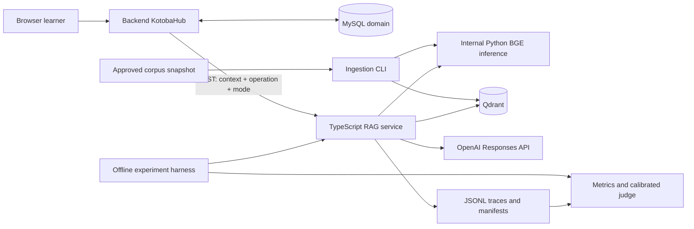
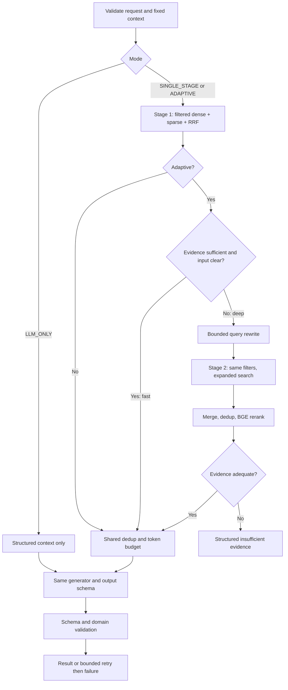

# Architecture — KotobaHub RAG

Versi 0.1 · 21 November 2026 · Status: desain yang akan diimplementasikan. Diagram, endpoint, struktur, dan konfigurasi di sini belum menjadi runtime yang tersedia.

## 1. Dasar keputusan

Urutan acuan adalah kebutuhan penelitian pada [PRD](PRD.md) dan draf TA, kontrak aplikasi yang benar-benar terpasang, kemudian referensi engineering. Konflik memerlukan pencatatan keputusan, bukan penggantian kontrak diam-diam.

| Status | Keputusan | Alasan |
| --- | --- | --- |
| Baseline draf | TypeScript mengorkestrasi mode, BGE-M3 untuk embedding, Qdrant untuk retrieval, BGE Reranker untuk deep path | Mengikuti subbab 3.7.7; bukan migrasi penuh ke Python hanya karena course memakai Python. |
| Usulan `DEC-01` | REST memakai Fastify; dependency injection via constructor/composition root | Cocok untuk service TypeScript terpisah dan pengujian policy tanpa framework. |
| Usulan `DEC-01` | Python internal inference memakai FlagEmbedding dan transport FastAPI | API inferensi BGE tetap kecil; tidak menduplikasi router dan policy generasi pada dua bahasa. |
| Konfigurasi KotobaHub saat ini | OpenAI Responses API menggunakan `gpt-5.6-terra` untuk generasi dan `gpt-5.6-luna` untuk normalisasi | Gunakan model yang sama per operasi pada ketiga mode eksperimen; verifikasi akses dan structured output pada pilot. |
| Dipilih untuk MVP | Manifest + JSONL lokal untuk artefak/trace eksperimen; backup ke storage terkontrol | Menghindari database telemetry tambahan sebelum kebutuhan query terbukti. |
| Ditunda | LangChain/LangGraph, LangSmith, Redis, queue, GraphRAG | Pipeline eksplisit sudah cukup untuk dua tahap dan memudahkan audit; course menjadi checklist, bukan stack wajib. |

Konfigurasi model yang menjadi acuan layanan RAG mengikuti KotobaHub saat ini:

```dotenv
OPENAI_GENERATION_MODEL=gpt-5.6-terra
OPENAI_NORMALIZATION_MODEL=gpt-5.6-luna
```

Pasangan model ini menggantikan kandidat model generatif pada draf TA. Draf TA asli tetap menjadi referensi historis dan perlu diselaraskan pada revisi laporan. Model dan parameter per operasi dibekukan sebelum eksperimen utama.

`DEC-01` merekam keputusan berikut konsekuensi setup dua runtime, alternatif TypeScript-only inference, dan hasil spike. Perubahan stack yang menyimpang dari TA harus disertai revisi dokumentasi sebelum implementasi terkait.

## 2. Konteks dan batas ownership



KotobaHub tetap source of truth untuk katalog, lesson eligibility, profile, progress, recommendation policy, sesi, dan jawaban. Service tidak menerima instruksi bebas untuk menjalankan SQL atau mengubah state learner. Context bundle dan dokumen retrieval adalah data tidak tepercaya di dalam prompt, bukan perintah sistem.

Data pembelajaran statis masuk lewat ekspor/snapshot yang disetujui, bukan query database live ketika eksperimen berjalan. Profil dan progres sintetis disertakan pada request dan tidak dimasukkan ke shared vector index. Dengan demikian kedua mode retrieval berbagi corpus sama dan tidak membocorkan learner context lintas request.

## 3. Temuan integrasi pada source saat ini

Diperiksa dari `/home/user/Testing/kotoba-hub` pada 21 November 2026; path berikut relatif terhadap repository aplikasi tersebut:

| Path/simbol | Fakta yang relevan |
| --- | --- |
| `src/backend/shared/application/services/requests/ai-request.ts` | `AiContextBundle` memuat catalog skill/lesson/unit/track, weak/mastered skills, recent mistakes, lessonUnderstanding, dan allowedQuestionTypes; locale EN/ID ada pada `AiLanguage`. |
| `src/backend/shared/application/services/ai.service.ts` | Use case AI diakses melalui service aplikasi. Boundary ini menjadi kandidat delegasi ke REST. |
| `src/backend/practice/interface/secondary/ai/practice-ai.adapter.ts` | `PracticeAiAdapter` mendelegasikan generate/grade ke `AiService`; ini bukan adapter HTTP RAG yang sudah tersedia. |
| `src/backend/shared/application/ports/ai-provider.port.ts` | `AiProviderPort.generate` menerima model/instructions/input/jsonSchema dan mengembalikan raw text/usage. Ini boundary provider-level; retrieval membutuhkan operasi dan structured context yang lebih tinggi. |
| `src/backend/shared/application/helpers/ai-schemas.ts` | Strict schema untuk empat tipe soal, grading, placement claims, recommendation, serta context. Extra metadata tidak boleh disisipkan ke dalam domain payload strict ini. |
| `src/backend/shared/application/services/impl/ai.service.impl.ts` | Validasi schema dan domain seperti jumlah soal, skill katalog, difficulty dan locale sudah ada; jalur existing juga memiliki retry/logging yang perlu diaudit. |
| `src/backend/shared/application/helpers/ai-templates.ts` | Template version 2 memisahkan empat operasi, melarang AI mengubah state domain, dan menjaga grading objective tetap deterministik. |
| `src/backend/shared/domain/repositories/ai-request-log.repository.ts` | Sudah memisahkan request log dan attempt log, usage termasuk cached input token. Perlu korelasi dengan trace service, bukan menghitung biaya yang sama dua kali. |
| `src/backend/shared/infrastructure/config/ai-env.ts` | `AI_PROVIDER` saat ini hanya menerima `OPENAI`; `OPENAI_GENERATION_MODEL=gpt-5.6-terra` dan `OPENAI_NORMALIZATION_MODEL=gpt-5.6-luna`. Mode RAG tidak dapat sekadar diaktifkan lewat environment yang belum didukung. |
| `src/backend/practice/domain/services/deterministic-answer-evaluator.ts` | Grading objective dimiliki rules engine; service ini tidak menggantikannya. |

Dokumen aplikasi `docs/drafts/ai-adapter-llm-only-and-rag-plus-llm.md` berguna sebagai desain awal, tetapi contoh `AiAdapter` di sana bukan bukti interface runtime terpasang. `CON-01` harus mengekspor fixture dari source/schema aktual, menyepakati boundary service-level, dan mendokumentasikan mismatch. Planning ini tidak mengedit repository aplikasi.

## 4. Struktur yang diusulkan

```text
kotoba-hub-rag/
  AGENTS.md                       # pedoman kerja lengkap
  README.md                       # pengantar dan navigasi dokumen
  PRD.md                          # kebutuhan produk dan penelitian
  ARCHITECTURE.md                  # desain layanan
  TASK_BREAKDOWN.md               # urutan task dan acceptance
  TECH_DEBT.md                    # register tech debt
  docs/                           # draf TA dan referensi lainnya
  agent-tooling/                   # paket subagent/skill dan installer
  .codex/agents/                   # target install role Codex
  .agents/skills/                  # target install skill proyek
  src/
    app.ts                        # bootstrap/composition root
    contracts/                    # wire schema, generated OpenAPI
    modules/
      generation/                 # operasi generate/grade/onboarding
      retrieval/                  # filtered hybrid search, fusion
      routing/                    # policy fast/deep
      context/                    # budgeting, citations, dedup
      observability/              # trace, usage, pricing
    shared/                       # errors, config, clock, ports
    adapters/                     # Qdrant, BGE HTTP, OpenAI, file sink
  inference/
    pyproject.toml                # Python BGE/FastAPI, locked later
    src/                          # embed/rerank handlers, no routing
    tests/
  scripts/
    ingestion/                    # snapshot -> chunks -> index
    experiments/                  # plan, run, resume, export
    evaluation/                   # metrics/statistics helpers
  prompts/                        # main templates and rewrite prompts
  configs/                        # retrieval/routing/pricing versions
  datasets/                       # reviewed pilot/main manifests
  tests/                          # unit, integration, contract
  artifacts/                      # generated runs, ignored by Git
```

Struktur runtime belum dibuat. Jangan menambah layer yang hanya membungkus satu fungsi; arah dependensi yang wajib dijaga adalah domain/policy tidak mengimpor SDK HTTP, Qdrant, atau OpenAI. Port minimum: `EmbeddingPort`, `RetrieverPort`, `RerankerPort`, `GeneratorPort`, `TraceSink`, `Clock`; adapter dipilih di composition root.

## 5. Kontrak REST yang diusulkan

Semua operasi server-to-server terautentikasi. Prefix `/v1`, correlation ID, batas body, timeout total, serta error envelope disepakati di `CON-01` sebelum coding.

| Endpoint usulan | Operasi aplikasi | Data domain pada `data` |
| --- | --- | --- |
| `POST /v1/practice/generate` | `GENERATE_PRACTICE_SESSION` | `GeneratedPracticeSession` |
| `POST /v1/practice/evaluate` | `GRADE_PRACTICE_ANSWER` | `GradedPracticeAnswer`, khusus FREE_RESPONSE |
| `POST /v1/onboarding/normalize` | `SUMMARIZE_PLACEMENT` | `PlacementSummary` |
| `POST /v1/onboarding/recommend` | `GENERATE_STUDY_RECOMMENDATION` | `StudyRecommendation` |
| `GET /health/live` | Liveness proses | Tidak memanggil model berbayar |
| `GET /health/ready` | Readiness dependency | Periksa model/index siap, tanpa generasi |

Envelope request konseptual:

```json
{
  "schema_version": "1",
  "request_id": "d5a2734b-9ad7-45ba-adc9-d54e05b95e1c",
  "mode": "SINGLE_STAGE",
  "corpus_version": "corpus-pilot-v1",
  "experiment": {
    "experiment_id": "pilot-v1",
    "case_id": "practice-simple-001",
    "repetition": 1
  },
  "payload": {}
}
```

`payload` pada contoh sengaja belum memuat fixture lengkap. Pada kontrak final, isinya input service existing per operasi, termasuk `context`, `language`, dan metadata. Petakan `request_id` ke `metadata.requestId`; jika keduanya dikirim dan berbeda, tolak. Jangan menganggap objek kosong valid. Metadata `experiment` bersifat opsional bagi integrasi biasa dan tidak diberikan ke prompt. Dataset labels/rubric evaluasi tidak masuk payload generasi.

Envelope sukses: `{schema_version, request_id, execution_id, mode, data, meta}`. `data` tepat mengikuti strict domain schema existing, sedangkan `meta` memuat `trace_id`, path, source citations yang sah, dan ringkasan usage/timing. Adapter HTTP aplikasi mengekstrak `data` lalu tetap menjalankan domain validation. `execution_id` baru untuk satu eksekusi aktual; response replay tidak boleh dianggap observasi eksperimen baru.

Envelope gagal: `{schema_version, request_id, execution_id, mode, error: {code, message, retryable}, meta: {trace_id}}`. Mapping yang diusulkan: 400 input/schema request, 401/403 auth, 409 snapshot/idempotency conflict, 422 unsupported level/insufficient evidence/post-validation failure, 429 capacity limit, 502 upstream/invalid generated schema, 503 dependency not ready, 504 deadline. Detail attempt ada pada trace tersanitasi; jangan mengirim raw prompt atau secret melalui error.

Mode dari caller harus tervalidasi dan diizinkan; tidak disimpulkan dari bahasa input. Auth memakai kredensial service yang dapat dirotasi di jaringan internal/TLS. Browser tidak memperoleh kredensial ini. Ingestion dan experiment runner awal berupa CLI, bukan endpoint admin publik.

## 6. Snapshot dan indexing

1. Ekspor materi eligible yang dipublikasikan dari KotobaHub, plus referensi/rubric terkurasi. Bekukan ID relasional, timestamps, source URL, lisensi, checksum, locale, dan versi kurasi. Konten bantu LLM harus sudah ditinjau peneliti sebelum dianggap resmi.
2. Tolak sumber tanpa provenance atau di luar N5/N4. Jangan crawl ulang Bunpro/Tatoeba/dll pada setiap run; gunakan hasil kurasi yang berlisensi dan snapshot tetap.
3. Normalisasi Unicode dengan kebijakan berversi; simpan teks Jepang asli. Jangan meratakan kanji/kana/romaji menjadi satu bentuk sehingga evidence atau grading kehilangan makna. Sanitasi HTML tanpa menghapus struktur contoh.
4. Chunk berdasarkan unit pedagogis: pola/arti/usage/contoh/terjemahan yang terkait. Parent ID dan offsets dipertahankan. Batas token dan overlap dipilih pada pilot; duplikasi overlap tidak boleh menggelembungkan ground truth.
5. Python inference menghasilkan dense vector serta sparse lexical weights BGE-M3 untuk dokumen dan query memakai tokenizer/revision/precision yang sama. Dense output saja dari library generik tidak memenuhi kebutuhan hybrid ini.
6. Upsert point ID deterministik dari corpus/source/chunk/content checksum. Qdrant memakai named dense+sparse vectors, metric dense yang dikunci, serta payload indexes untuk filter. BGE-M3 default dense 1.024 dimensi; validasi dimensi actual saat bootstrap.
7. Buat collection per index revision; validasi count/checksum/filter/search smoke sebelum dipromosikan. Pin physical collection di manifest main run; perubahan alias tidak boleh mengubah corpus di tengah eksperimen. Penghapusan materi memerlukan reindex/snapshot baru atau explicit delete.

Metadata chunk minimum: `chunk_id`, `parent_id`, `corpus_version`, `source_id`, `source_url`, `license`, `content_checksum`, `track_slug`, `unit_slug`, `lesson_slug`, `skill_codes`, `jlpt_level`, `locale`, `content_type`, `published`, `chunk_index`, `token_count`, `embedding_revision`, `chunking_version`. Dokumen bilingual harus mempunyai metadata jelas; contoh Jepang boleh berada dalam penjelasan EN/ID.

Ground truth retrieval mengacu pada stable source/parent dan chunk mapping versi snapshot. Jika beberapa chunk overlap mendukung evidence sama, gunakan kebijakan dedup relevance yang dibekukan agar recall tidak naik semu. Simpan raw retrieval dan context terpakai sehingga dampak truncation dapat diaudit.

## 7. Pipeline dan definisi stage

Satu **retrieval stage** berarti satu putaran pencarian kandidat dense+sparse dengan filter dan fusion tetap. Dua cabang dense/sparse dalam satu putaran bukan dua stage; reranking cross-encoder juga dicatat sebagai operasi tersendiri, bukan putaran retrieval baru. Counter menyimpan keduanya agar terminologi tidak ambigu.



### Shared base retrieval

Filter wajib: pinned corpus, published/eligible material, allowed levels dan katalog/skill yang diizinkan caller. Hard filter hanya pada otorisasi/cakupan; target skill prioritas dapat menjadi query/boost jika multi-skill dibutuhkan. Deep path tidak boleh melepas batas silabus untuk memperoleh hit tambahan. Kandidat diambil memakai query dense+sparse BGE lalu Reciprocal Rank Fusion (RRF); raw dense/sparse score dan fusion rank disimpan terpisah. Jangan menjumlahkan raw score dua skala sebagai confidence.

`SINGLE_STAGE` selalu berhenti setelah putaran awal. Deduplikasi dan token budgeting berlaku pada semua mode RAG. Jika evidence tidak cukup, single-stage memberi error yang tercatat; tidak meniru deep path atau fallback LLM-only. Pembanding tambahan single-stage+reranker boleh menjadi ablation, tetapi tidak menggantikan baseline utama setelah main run dimulai.

### Router adaptive

Router awal diusulkan deterministik agar dapat diaudit. Fitur berasal dari input serta stage 1: jumlah kandidat unik, coverage target skill, kualitas dense/fusion terkalibrasi, gap kandidat, kelengkapan profil, dan konflik constraints. `complexity`, `expected_route`, reference answer evaluasi, dan skor judge tidak boleh menjadi fitur router.

Routing tidak menggunakan threshold universal seperti cosine 0,7 tanpa kalibrasi. Kalibrasikan pada pilot, simpan feature normalization dan policy version. Missing/low evidence atau konflik yang bisa diselesaikan lewat evidence memilih deep; input invalid atau constraint bertentangan yang tak dapat dipenuhi ditolak sebelum panggilan model. Simpan expected routing label hanya di evaluator, predicted route di trace. Tidak semua kasus ambigu harus dipaksakan mempunyai output sukses.

### Deep path

Usulan awal: maksimum dua retrieval stage total; satu rewrite opsional; stage 2 memakai query yang dipertajam atau pool lebih luas dengan hard filter sama; merge/dedup kandidat awal dan lanjutan; rerank menggunakan `BAAI/bge-reranker-v2-m3`; evaluasi evidence akhir; assemble context. Semua nilai adalah konfigurasi pilot, lalu dikunci. Tidak ada loop agent bebas atau retry sampai skor memuaskan.

Rewrite mengubah query pencarian, bukan target skill, difficulty, locale, atau kebenaran jawaban. Candidate reference answer dari kontrak grading adalah konteks domain yang sah; jawaban acuan rahasia milik dataset evaluasi tetap terpisah. Model rewrite, jika dipakai, dipin dan biaya/latensinya masuk request total.

## 8. Context dan generasi

Pemilihan model mengikuti pemetaan operasi pada `AiServiceImpl` KotobaHub saat ini:

| Operasi | Konfigurasi | Model |
| --- | --- | --- |
| `GENERATE_PRACTICE_SESSION` | `OPENAI_GENERATION_MODEL` | `gpt-5.6-terra` |
| `GRADE_PRACTICE_ANSWER` | `OPENAI_GENERATION_MODEL` | `gpt-5.6-terra` |
| `SUMMARIZE_PLACEMENT` | `OPENAI_NORMALIZATION_MODEL` | `gpt-5.6-luna` |
| `GENERATE_STUDY_RECOMMENDATION` | `OPENAI_GENERATION_MODEL` | `gpt-5.6-terra` |

Pemetaan model dan parameter per operasi harus sama pada `LLM_ONLY`, `SINGLE_STAGE`, dan `ADAPTIVE`. Model rewrite dan evaluator, jika digunakan, dikonfigurasi serta dicatat terpisah dari dua konfigurasi di atas.

Main prompt memisahkan instruksi sistem, context bundle, retrieved evidence dengan source IDs, dan data learner. Ketiga mode memakai template/operation schema yang sama, dengan retrieved evidence kosong pada baseline. Snapshot katalog yang diizinkan tetap menjadi hard constraint.

Token budgeting mengalokasikan ruang untuk system prompt, input, structured profile, evidence, output, dan safety margin. Context builder membuang duplikasi lalu memilih evidence sesuai rank/coverage, menyimpan `retrieved`, `selected`, dan `dropped` IDs beserta alasannya. Jangan memotong tengah kalimat/pola Jepang atau menghapus semua evidence untuk target skill tanpa menandainya. Context cap sama antar kedua mode RAG; jumlah token aktual boleh berbeda sebagai bagian perlakuan.

Structured output diparse dan diperiksa terhadap JSON Schema/Zod hasil kontrak. Domain post-validation mencakup count, allowed skill/type, difficulty, pola blank, option/token IDs, arah terjemahan, locale, dan konsistensi lesson-unit-track. Citation metadata hanya memuat sumber yang benar-benar dipilih; jangan menambahkan field citation ke payload domain strict.

Hasil tidak langsung mengubah profil, mastery, atau sesi. KotobaHub tetap mengotorisasi dan memvalidasi sebelum menyimpannya. Onboarding claims memerlukan konfirmasi learner sesuai flow aplikasi.

## 9. Retry, deadline, cache, dan fallback

- Deadline dimulai pada adapter KotobaHub menerima permintaan; simpan juga durasi internal service dan network overhead. Setiap call/stage memakai remaining budget; deadline memicu cancellation bila didukung.
- Orkestrator service menjadi owner retry provider. SDK auto-retry dinonaktifkan atau diikutkan eksplisit; client aplikasi tidak mengulang eksekusi AI tanpa identitas/counter yang tercatat.
- Error transient dapat di-retry dengan backoff berjitter dan batas attempt. Input/auth/out-of-scope tidak di-retry. Schema repair bila dipakai mengikuti budget retry bersama dan dicatat sebagai call tersendiri pada semua mode.
- Retrieval escalation adalah perlakuan adaptive, bukan provider retry. Gunakan `retrieval_stage_count`, `rewrite_call_count`, `rerank_call_count`, `provider_retry_count`, `schema_retry_count`, dan total attempt terpisah.
- Tidak ada fallback mode dalam eksperimen utama. Fallback ke baseline untuk produk kelak harus flag eksplisit, trace `requested_mode`/`executed_mode`, dan cohort terpisah.
- Main run menonaktifkan response/query cache; model weights boleh warm. Dokumentasikan provider cached tokens, shared warmup, concurrency dan load. Jangan menghangatkan adaptive saja.
- Idempotency operasional mengembalikan hasil eksekusi sama untuk key sama; lima repetition memiliki request IDs berbeda. Resume harness memakai terminal record/checkpoint sehingga tidak membuat duplikat observasi. Bila crash setelah provider call sebelum durable trace, catat outcome unknown beserta kemungkinan biaya tak diketahui; re-execution mendapat execution ID baru.

## 10. Telemetry dan penyimpanan eksperimen

Setiap run menghasilkan manifest immutable, event JSONL per execution (menghindari concurrent writers ke file sama), terminal results, evaluator scores, lalu summary CSV/JSON. Checksum menghubungkan artefak dan raw evidence. Atur atomic finalization dan rekonsiliasi unfinished execution; kegagalan sink trace membuat run tidak layak main analysis sampai diperbaiki.

| Kelompok | Field minimum |
| --- | --- |
| Identitas | experiment/case/repetition/request/execution/trace IDs, operasi dan suboperasi, mode, commit |
| Versi | dataset, corpus/index, chunking, embedding/reranker revision, main/rewrite/evaluator prompts, schemas, retrieval/router configs |
| Routing | initial decision, final path, reason codes, features, thresholds, stage/rewrite/rerank counts |
| Retrieval | query tersanitasi atau hash, filters, per-stage chunk/source IDs, raw scores + score type, rank, selected/dropped evidence |
| Model calls | call purpose/provider/model/version/request ID, attempt index, timing, actual usage/cached tokens, price version, estimated cost |
| Outcome | schema parse status per attempt/final, domain validation status, terminal success/failure, errors dengan kategori/cause |
| Lingkungan | timestamp UTC, monotonic durations, hardware/runtime/dependency versions, model precision, seed bila didukung, concurrency/cache/warmup |

Errors dibedakan: `INVALID_INPUT`, `AUTH_FAILED`, `UNSUPPORTED_LEVEL`, `SNAPSHOT_MISMATCH`, `RETRIEVAL_FAILED`, `INSUFFICIENT_EVIDENCE`, `INFERENCE_FAILED`, `PROVIDER_FAILED`, `TIMEOUT`, `SCHEMA_PARSE_FAILED`, `POST_VALIDATION_FAILED`, `TRACE_WRITE_FAILED`. Simpan request failure tunggal dan daftar error events; retry bisa menghasilkan banyak event untuk satu request gagal/sukses.

`inference_total_cost` menjumlahkan call generasi, rewrite, repair, dan retry. Cached input dipisahkan dari non-cached input sesuai usage; jangan membebankan keduanya pada token sama. `null` berarti tidak diketahui, bukan nol. Usage terlapor SDK/provider direkonsiliasi dengan pricing snapshot bertanggal. Biaya indexing/BGE hosting dan evaluasi judge dilaporkan di kolom terpisah. Parent trace onboarding menjumlahkan suboperasi tanpa menggandakan data usage child.

Trace minimal tidak perlu chain-of-thought atau data pengguna asli. Catat reason codes dan evidence yang diperlukan audit, sanitasi note/jawaban, dan simpan akses artefak secara terbatas. LangSmith/OpenTelemetry dapat ditambahkan sebagai adapter, tetapi artefak lokal tetap sumber data eksperimen agar hasil tidak tergantung dashboard eksternal.

## 11. Test dan deployment minimum

Unit tests menyasar ranking/filter policy, route boundary, dedup/token budget, terminasi, validation, biaya, dan counter. Integration tests menggunakan Qdrant sementara dan BGE fixture; model BGE aktual diuji pada smoke opt-in. Contract tests memakai fixture yang diparse validator aplikasi. Provider OpenAI dimock untuk CI; paid smoke/pilot/main run terpisah dan memerlukan konfigurasi nyata serta budget yang telah ditetapkan.

Compose kelak memuat orchestrator, BGE inference, Qdrant, persistent volumes, dan health checks. API internal dapat diakses backend KotobaHub; Qdrant/BGE hanya jaringan internal. Pin image digest/dependency lock/revision model, batasi concurrency/body/batch, muat model sekali saat startup, dan jangan download model setiap request. Backup snapshot/index dan artefak; uji restore pada task operasional. Kubernetes dan autoscaling tidak menjadi syarat eksperimen.

## 12. Pemetaan course dan sumber teknis

| Topik course | Adaptasi proyek | Task |
| --- | --- | --- |
| Loader, chunking, embedding dimension | Snapshot kurasi N5/N4, chunk pedagogis, BGE dense+sparse | DATA-01–03, INF-01 |
| Similarity score, debugging | Trace tiap stage; bedakan score internal dan metrik ground truth | RAG-01, OBS-01, EVAL-01 |
| Hybrid search dan token budget | Qdrant dense+sparse RRF, context cap bersama | RAG-01–02 |
| Observability, optimization, costs | Trace/call accounting, pilot dan ablation terpisah | OBS-01–02, EXP-01 |
| Production security, API, hosting | Auth, batas resource, injection tests, Compose/restore | API-01, TEST-02, OPS-01 |
| Self-correcting/advanced RAG | Deep path dua tahap; GraphRAG/multimodal/debate ditunda | ADP-01–02 |

Referensi primer untuk implementasi, diperiksa 21 November 2026:

- [BAAI BGE-M3 model card](https://huggingface.co/BAAI/bge-m3): embedding multibahasa dense/sparse dan contoh FlagEmbedding. [BGE Reranker v2 M3](https://huggingface.co/BAAI/bge-reranker-v2-m3): cross-encoder multilingual.
- [Qdrant hybrid queries](https://qdrant.tech/documentation/search/hybrid-queries/): prefetch/fusion beberapa query. Implementasi harus mengikuti versi server/client yang dikunci.
- [Fastify validation dan serialization](https://fastify.dev/docs/latest/Reference/Validation-and-Serialization/): kontrak request/response schema pada API usulan.
- [Official OpenAI documentation: subagents](https://learn.chatgpt.com/docs/agent-configuration/subagents) dan [skills](https://learn.chatgpt.com/docs/build-skills): format role lokal dan discovery skill; kemampuan aktual tetap mengikuti versi client/session.
- [Course freeCodeCamp](https://www.freecodecamp.org/news/production-rag-with-langchain-vector-databases/) beserta transkrip lokal adalah referensi cakupan engineering. Detail pedagogis/angka penelitian mengikuti [draf TA](docs/Andrian_41522120004_TA_Draft.docx).
