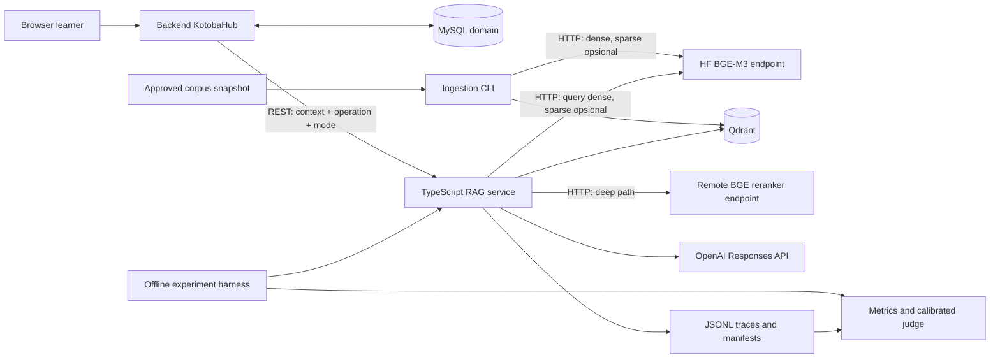
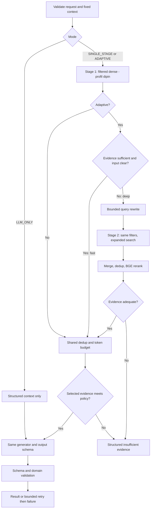

# Architecture — KotobaHub RAG

Versi 0.24 · 27 November 2026 · Status: desain dengan runtime health-only BOOT-01 dan adapter HTTP HF INF-02 serta Compose/lifecycle Qdrant STORE-01 opt-in dan preparation corpus offline DATA-02. [ADR-002](docs/ADR-002-hf-dense-optional-sparse.md) memilih HF Serverless, dense wajib/sparse opsional; [protokol v2-dense](docs/research/RES-02-dense-amendment.md) belum freeze. SINGLE_STAGE internal tersedia pada RAG-03; router ADP-01 dan runner/deep path internal ADP-02 tersedia; lifecycle/retry terpadu ADP-03 tersedia; endpoint operasi tetap rancangan; INF-01 DONE menurut acceptance pengguna 24 November 2026; metadata provider yang belum terkonfirmasi tetap unknown. Boundary DDD REF-01 tersedia; endpoint operasi tetap API-01.

## 1. Dasar keputusan

Urutan acuan adalah kebutuhan penelitian pada [PRD](PRD.md) dan draf TA, kontrak aplikasi yang benar-benar terpasang, kemudian referensi engineering. Konflik memerlukan pencatatan keputusan, bukan penggantian kontrak diam-diam.

| Status | Keputusan | Alasan |
| --- | --- | --- |
| Baseline draf | TypeScript mengorkestrasi mode, BGE-M3 untuk embedding, Qdrant untuk retrieval, BGE Reranker untuk deep path | Mengikuti subbab 3.7.7; bukan migrasi penuh ke Python hanya karena course memakai Python. |
| Diterima `DEC-01` | Node 24.22.3/npm 11.19.1, TypeScript 5.9.3, Fastify 5.12.8; constructor/composition root | Kombinasi lint/typecheck/build dan schema smoke diuji; versi dan lock strategy ada pada ADR-001. |
| Keputusan DOC-INF-03 / ADR-002; INF-01 DONE | HF Serverless dengan provider eksplisit `hf-inference` untuk BGE | BGE-M3 dense wajib/sparse opsional; BGE Reranker v2 M3 tetap. Smoke dense/pair rerank berhasil; konfirmasi served revision/region/retensi/limits dan exact billing dikeluarkan dari requirement INF-01, dengan unknown tetap eksplisit. |
| Alternatif bersyarat `DOC-INF-02` | Dedicated/custom container/server terpisah, dengan Python 3.12/FlagEmbedding/FastAPI jika handler sendiri dibutuhkan | Evaluasi setelah API siap pakai dan budget; Python/GPU lock hanya untuk alternatif ini. Routing/generasi tetap TypeScript; tidak ada failover runtime otomatis. |
| Konfigurasi KotobaHub saat ini | OpenAI Responses API menggunakan `gpt-5.6-terra` untuk generasi dan `gpt-5.6-luna` untuk normalisasi | Gunakan model yang sama per operasi pada ketiga mode eksperimen; verifikasi akses dan structured output pada pilot. |
| Dipilih untuk MVP | Manifest + JSONL lokal untuk artefak/trace eksperimen; backup ke storage terkontrol | Menghindari database telemetry tambahan sebelum kebutuhan query terbukti. |
| Ditunda | LangChain/LangGraph, LangSmith, Redis, queue, GraphRAG | Pipeline eksplisit sudah cukup untuk dua tahap dan memudahkan audit; course menjadi checklist, bukan stack wajib. |

Konfigurasi model yang menjadi acuan layanan RAG mengikuti KotobaHub saat ini:

```dotenv
OPENAI_GENERATION_MODEL=gpt-5.6-terra
OPENAI_NORMALIZATION_MODEL=gpt-5.6-luna
```

Pasangan model ini menggantikan kandidat model generatif pada draf TA. Draf TA asli tetap menjadi referensi historis dan perlu diselaraskan pada revisi laporan. Model dan parameter per operasi dibekukan sebelum eksperimen utama.

`DEC-01` selesai pada [ADR-001](docs/ADR-001-stack-and-inference.md) untuk stack, matriks versi/lock dan spike awal; DOC-INF-02 mengubah prioritas deployment menjadi API per pemakaian karena biaya/maintenance penelitian. Qdrant server/client awal 1.20.2/1.20.0; checks ESLint 10, typescript-eslint 8.73, Prettier 3.10.1 dan native node:test. Target app/Qdrant Linux amd64/Debian 12 melalui Compose, ukuran awal 2 vCPU/4 GiB tanpa GPU berdasarkan startup smoke, bukan kapasitas produksi. `INF-01` memverifikasi API HF yang dipilih melalui DOC-INF-03, revision, kapasitas dan biaya; Python/GPU lock hanya jika alternatif handler sendiri dipilih. Identitas model mengikuti TA; penempatan remote adalah penyesuaian engineering. Draf TA asli tetap historis dan uraian deployment diselaraskan pada revisi laporan.

### Penempatan dan kontrak inferensi

Inference provider adalah layanan eksekusi model, berbeda dari repository model di Hugging Face Hub. Hugging Face Inference Providers menawarkan akses model melalui penyedia; Inference Endpoints adalah opsi deployment dedicated dengan konfigurasi deployment tersendiri. Ketersediaan `bge-m3`/reranker dan dukungan sparse tidak diasumsikan hanya dari nama model. API feature extraction umum mendokumentasikan array embedding; itu bukan bukti keluaran sparse BGE-M3. Audit sumber resmi dan smoke endpoint aktual diperlukan.

Keputusan aktif DOC-INF-03 memilih HF Serverless (`hf-inference`), profil DENSE. Dense BGE-M3 wajib dan sparse opsional; pilihan ini menggantikan kewajiban hybrid/urutan seleksi DOC-INF-02. Tidak ada auto-routing, fallback provider/lokal atau penggantian model. Jika operasi/revision HF gagal gate, catat kegagalan dan perlukan keputusan lanjutan. Sparse hanya diaktifkan lewat profil HYBRID pada konfigurasi/protokol baru setelah bukti capability/index/pilot tersedia.

Audit dokumentasi 22 November 2026: HF Feature Extraction belum mengontrakkan sparse weights; [TEI PR #899](https://github.com/huggingface/text-embeddings-inference/pull/899) sparse BGE-M3 masih terbuka. Kandidat alternatif [SIE Serverless–Qdrant](https://qdrant.tech/documentation/embeddings/superlinked/) mendokumentasikan dense+sparse BGE-M3; ini belum membuktikan served revision/latency/billing aktual proyek. [Katalog SIE](https://superlinked.com/models?task=score) belum mencantumkan BGE Reranker v2 M3 sebagai serverless, sehingga audit reranker tetap terpisah. Tidak ada call model berbayar pada audit dokumentasi ini.

| Komponen | Lokasi/kontrak yang direncanakan |
| --- | --- |
| Orkestrator TypeScript | Laptop/server aplikasi tanpa kewajiban memasang weights BGE; adapter HTTP mengimplementasikan `EmbeddingPort` dan `RerankerPort`. |
| Embedding | HF Serverless BGE-M3; dense wajib, sparse opsional. Dokumen/query wajib kompatibel. Port `EmbeddingVector` mendukung sparse absen; tipe `HybridVector` tetap mewajibkannya. |
| Reranker | Endpoint remote terpilih, boleh terpisah dari embedding; model `BAAI/bge-reranker-v2-m3`, skor dipetakan kembali ke ID kandidat, urutan dan normalisasi skor terdokumentasi. |
| Handler Python opsional | Custom handler/container terkelola atau service di mesin inferensi terpisah jika provider standar belum cukup. Tidak harus berjalan bersama aplikasi; lokal hanya jika hardware layak. |
| Qdrant | Tetap layanan vector store yang diakses adapter; tidak mengambil alih eksekusi model BGE. |

Acceptance INF-01 yang selesai mencakup smoke dense JA/EN/ID, dimensi/finite/cardinality/norm dan pair rerank ID/score. Pengguna pada 24 November 2026 menghapus keharusan konfirmasi served model/tokenizer/processing revision, region/retensi dan batas provider termasuk max length/truncation/batch/concurrency/rate limit; data yang belum diketahui tetap unknown. Limit klien pada INF-02 bukan klaim kapasitas provider. Sparse/token mapping hanya wajib untuk HYBRID. Dense-only valid pada DENSE; malformed sparse yang disertakan tetap gagal. Missing sparse pada HYBRID tidak boleh downgrade otomatis. Served revision yang tak terbukti tetap memblokir freeze; reranker tidak dinonaktifkan oleh keputusan ini.

Konfigurasi dipisahkan per operasi: provider aktual, model/revision yang diminta dan terverifikasi, endpoint/API/deployment revision yang tersedia, region, auth secret reference, timeout, limit dan pricing unit. Contoh nama konseptual: `EMBEDDING_PROVIDER`/`EMBEDDING_ENDPOINT` dan `RERANKER_PROVIDER`/`RERANKER_ENDPOINT`; env aktual baru dibuat pada BOOT/INF. Jangan commit token atau URL bertoken. Tidak ada pemilihan provider otomatis atau fallback lokal saat error; kegagalan dependency eksplisit. Pembelian kredit/call API berbayar tetap memerlukan scope/budget; SKU/provisioning/Python image hanya diperlukan jika alternatif dedicated/self-hosted dipilih.

Simpan bukti deployment/config/attestation untuk revision yang tidak dikembalikan API; nama model saja tidak cukup. Hardware/precision yang tidak diekspos provider ditulis `unknown`, beserta batas observasi. Ketidakpastian identitas model/revision harus diselesaikan sebelum freeze; fingerprint smoke tidak menggantikan pinning revision. Region, shared-load/queue, network, cold-start dan scale-to-zero dicatat sebagai faktor lingkungan. Endpoint dan konfigurasi embedding yang sama dipakai kedua mode RAG; setelah freeze pergantian provider/deployment menjadi cohort baru, dengan validasi ulang index/reindex bila konfigurasi embedding berubah.

Progres INF-01 (24 November 2026): **DONE** sesuai [keputusan acceptance pengguna](docs/inference/INF-01-acceptance-decision.json) dan [laporan penutupan](docs/inference/INF-01-completion.md). Smoke 13 POST membuktikan dense JA/EN/ID dan pair rerank; sparse tidak dikembalikan dan tetap opsional pada DENSE. Konfirmasi served model/tokenizer/processing revision, region/retensi dan batas layanan dikeluarkan dari requirement INF-01; metadata tersebut tetap unknown/unverified. Billing exact juga tidak diwajibkan; laporan tampilan `< USD 0,01` dan biaya null dipertahankan. Bukti smoke tidak ditulis ulang, tanpa request tambahan. Penutupan task tidak berarti penelitian sudah freeze.

### Adapter yang tersedia pada INF-02

`src/modules/rag/interface/secondary/inference/hf-inference.ts` mengimplementasikan `EmbeddingPort` dan `RerankerPort` melalui `fetch` bawaan Node. Config `hf-inf-02-v1` menetapkan `hf-inference`, kedua model/endpoint INF-01, embedding `normalize=true`/`truncate=false`, dan reranker pair `function_to_apply=none`. Endpoint TLS tetap dan redirect ditolak; served revision/tokenizer/processing/region tetap null. Konfigurasi dan input disalin sebelum operasi async agar profil/parameter tidak berubah saat call berlangsung. Kedua mode RAG memakai instance/config embedding yang sama melalui composition RAG.

Embedding dipotong menjadi batch berurutan; rerank memakai batch pasangan, memetakan skor menurut urutan input, kemudian stable sort menurun menurut skor. Score type `hf_none_raw_logit_unverified` tidak mengklaim probabilitas atau kualitas retrieval. Wire pair berasal dari capture INF-01, belum jaminan kontrak publik HF. DENSE menerima dense-only 1024 dimensi finite/nonzero. Validator normalized memeriksa sparse jika disertakan dan mewajibkannya pada HYBRID; adapter HF sendiri menolak HYBRID sebelum jaringan karena capability sparse belum terbukti, tanpa downgrade/provider fallback.

Batas klien default: embedding batch 1, rerank batch 2, concurrency bersama 1, maksimum 128 item/call, 8.192 UTF-16 code units per teks, timeout HTTP/batch 15 detik dan response 2 MiB. Ini bukan batas kapasitas/token provider. Tidak ada antrean adapter atau SDK retry; HTTP retry opt-in dikendalikan ADP-03 per execution, sedangkan pemakaian tanpa kontrol tetap satu attempt. Admission berlebih mengembalikan `CAPACITY_LIMIT`. Deadline total caller dibatasi lagi dengan budget monotonic lintas batch dan callback observer. Abort diteruskan ke transport dan body reader; slot concurrency tetap ditahan bila transport mengabaikan abort sampai operasi transport benar-benar settle. Timeout tidak membuktikan penghentian inferensi remote.

Setiap attempt HTTP, termasuk failure/partial batch, menghasilkan ID unik, execution ID, purpose, identity/config tanpa token, UTC timestamp, durasi monotonic, status/request ID provider, error dan Retry-After. Usage/cost tetap null. Callback `onAttempt` wajib dan dibatasi; kegagalan pencatatan menutup call dengan `ATTEMPT_OBSERVER_FAILED`. Composition root kini menunggu JSONL durable OBS-01 melalui observer dan memeriksa admission aktif sebelum transport. OBS-02 menambahkan accounting/snapshot harga dengan usage dan biaya HF tetap null. Admission failure sebelum HTTP bukan model attempt. `capabilities()` adalah pembacaan lokal, dengan bukti INF-01 dan attempt terakhir; tidak memeriksa availability provider saat ini. Health tetap 503 sampai indeks/pipeline terhubung. Detail konfigurasi, error dan bukti ada pada [laporan INF-02](docs/inference/INF-02-adapter.md).

## 2. Konteks dan batas ownership



KotobaHub tetap source of truth untuk katalog, lesson eligibility, profile, progress, recommendation policy, sesi, dan jawaban. Service tidak menerima instruksi bebas untuk menjalankan SQL atau mengubah state learner. Context bundle dan dokumen retrieval adalah data tidak tepercaya di dalam prompt, bukan perintah sistem.

Data pembelajaran statis masuk lewat ekspor/snapshot yang disetujui, bukan query database live ketika eksperimen berjalan. Profil dan progres sintetis disertakan pada request dan tidak dimasukkan ke shared vector index. Dengan demikian kedua mode retrieval berbagi corpus sama dan tidak membocorkan learner context lintas request.

Node inferensi menggambarkan boundary endpoint, bukan kewajiban satu provider/mesin. Handler Python dapat berada di balik endpoint bila dibutuhkan. Kirim hanya query/chunk yang diperlukan lewat TLS server-to-server; jangan mengirim seluruh context bundle/profil ke layanan embedding/rerank. Audit retensi, region dan payload egress pada pemilihan provider; kredensial hanya di server.

## 3. Temuan integrasi pada source saat ini

Diperiksa dari `/home/user/Testing/kotoba-hub` pada 21 November 2026; path berikut relatif terhadap repository aplikasi tersebut:

| Path/simbol | Fakta yang relevan |
| --- | --- |
| `src/backend/shared/application/services/requests/ai-request.ts` | `AiContextBundle` memuat catalog skill/lesson/unit/track, weak/mastered skills, recent mistakes, lessonUnderstanding, dan allowedQuestionTypes; locale EN/ID ada pada `AiLanguage`. |
| `src/backend/shared/application/services/ai.service.ts` | Use case AI diakses melalui service aplikasi. Boundary ini menjadi kandidat delegasi ke REST. |
| `src/backend/practice/interface/secondary/ai/practice-ai.adapter.ts` | `PracticeAiAdapter` mendelegasikan generate/grade ke `AiService`; ini bukan adapter HTTP RAG yang sudah tersedia. |
| `src/backend/shared/application/ports/ai-provider.port.ts` | `AiProviderPort.generate` menerima model/instructions/input/jsonSchema dan mengembalikan raw text/usage. Ini boundary provider-level; retrieval membutuhkan operasi dan structured context yang lebih tinggi. |
| `src/backend/shared/application/helpers/ai-schemas.ts` | Strict schema untuk empat tipe soal, grading, placement claims, recommendation, serta context. Extra metadata tidak boleh disisipkan ke dalam domain payload strict ini. |
| `src/backend/shared/application/services/impl/ai.service.impl.ts` | Validasi schema dan domain seperti jumlah soal, skill katalog, difficulty dan locale sudah ada; jalur existing juga memiliki retry/logging yang perlu diaudit. |
| `src/backend/shared/application/helpers/ai-templates.ts` | Template version 2 memisahkan empat operasi, melarang AI mengubah state domain, dan menjaga grading objective tetap deterministik. |
| `src/backend/shared/domain/repositories/ai-request-log.repository.ts` | Sudah memisahkan request log dan attempt log, usage termasuk cached input token. Perlu korelasi dengan trace service, bukan menghitung biaya yang sama dua kali. |
| `src/backend/shared/infrastructure/config/ai-env.ts` | `AI_PROVIDER` saat ini hanya menerima `OPENAI`; `OPENAI_GENERATION_MODEL=gpt-5.6-terra` dan `OPENAI_NORMALIZATION_MODEL=gpt-5.6-luna`. Mode RAG tidak dapat sekadar diaktifkan lewat environment yang belum didukung. |
| `src/backend/practice/domain/services/deterministic-answer-evaluator.ts` | Grading objective dimiliki rules engine; service ini tidak menggantikannya. |

Dokumen aplikasi `docs/drafts/ai-adapter-llm-only-and-rag-plus-llm.md` berguna sebagai desain awal, tetapi contoh `AiAdapter` di sana bukan bukti interface runtime terpasang. Audit ulang [CON-01](docs/contracts/CON-01.md) pada 23 November 2026 mengunci commit/source hashes, mengekspor schema/fixture dan menguji domain validator aktual. Temuan tambahan: rekomendasi consumer aplikasi masih deterministik; method AI rekomendasi belum terhubung, timeout existing per-attempt dan schema/domain failure masih digabung. Rencana adapter service-level dan perubahan v1 tercatat pada laporan; repository aplikasi tidak diedit.

## 4. Struktur runtime REF-01

Runtime REF-01 berada pada `src/modules/knowledge`, `rag`, `execution` dan `observability`, dengan bootstrap proses pada `src/main.ts`, `src/app.ts` dan `src/bootstrap/`. [Laporan REF-01](docs/architecture/REF-01-ddd-refactor.md) mencatat pemetaan source, kontrak aplikasi dan bukti regresi; [rencana awal](docs/architecture/REF-01-ddd-refactor-plan.md) tetap menjadi acuan ownership dan acceptance. Tree di bawah menunjukkan struktur modul yang sudah tersedia; folder inference/scripts/datasets tetap bersifat rencana sesuai task masing-masing.

```text
kotoba-hub-rag/
  AGENTS.md                       # pedoman kerja lengkap
  README.md                       # pengantar dan navigasi dokumen
  PRD.md                          # kebutuhan produk dan penelitian
  ARCHITECTURE.md                  # desain layanan
  TASK_BREAKDOWN.md               # urutan task dan acceptance
  TECH_DEBT.md                    # register tech debt
  docs/                           # draf TA dan referensi lainnya
  agent-tooling/                   # paket subagent/skill dan installer
  .codex/agents/                   # target install role Codex
  .agents/skills/                  # target install skill proyek
  src/
    main.ts                       # lifecycle proses
    app.ts                        # bootstrap/composition root
    bootstrap/                    # konfigurasi proses, CLI rekonsiliasi/indexing dan wiring store
    contracts/                    # wire CON-01 dan generated types
    modules/
      knowledge/                  # corpus/chunking/provenance/index lifecycle
      rag/                        # retrieval/context/generation/router/evidence
      execution/                  # admission/terminal/deadline/retry/call budget
      observability/              # pendukung trace/accounting/reconciliation
      # Tiap modul memakai domain/application/interface/infrastructure
    shared/                       # primitive/clock; tidak mengimpor modul fitur
  inference/                      # opsional: hanya bila perlu handler/service sendiri
    pyproject.toml                # Python/FlagEmbedding; FastAPI jika transport sendiri
    src/                          # remote custom handlers atau service; no routing
    tests/
  scripts/
    ingestion/                    # snapshot -> chunks -> index
    experiments/                  # plan, run, resume, export
    evaluation/                   # metrics/statistics helpers
  prompts/                        # main templates and rewrite prompts
  configs/                        # retrieval/routing/pricing versions
  datasets/                       # reviewed pilot/main manifests
  tests/
    __fixtures__/                 # fixture/helper bersama unit dan integration
    unit/<fitur>/                 # test menurut tanggung jawab modul, termasuk contracts
    integration/<fitur>/          # storage, ingestion, retrieval dan pipelines
  artifacts/                      # generated runs, ignored by Git
```

BOOT-01 membuat entrypoint/composition root health-only, konfigurasi dan port awal, clock adapter, tipe kontrak generated, validator Ajv serta tests. Task INF/STORE/DATA/OBS/BASE/RAG/ADP kemudian menambahkan implementasi pada folder fitur sebelumnya. REF-01 memigrasikan folder fitur tersebut ke modul DDD; tidak ada folder kosong untuk backlog. `spikes/dec-01/` tetap fixture/evidence historis, terpisah dari root runtime.

REF-01 memisahkan `domain` murni, `application` untuk use case/kontrak dependency, `interface/primary` untuk REST/CLI, `interface/secondary` untuk adapter dan `infrastructure` untuk konfigurasi/wiring. Kontrak service eksplisit menggantikan dependency caller pada tipe factory atau adapter konkret. Consumer-owned port diimplementasikan adapter consumer yang memanggil facade application pemilik; repository/file internal tidak diakses lintas modul. Domain/application tidak mengimpor SDK, filesystem atau composition root. Shared hanya berisi abstraksi netral.

`rag` memakai facade knowledge/execution serta port audit; execution menerima callback pekerjaan sehingga tidak mengimpor runner RAG. Observability menerima record audit netral; koordinator rekonsiliasi CLI merangkai query registry execution dan audit dari boundary bootstrap. Invariant wire/prompt/model, topology tiga mode, deadline/retry, durable registry/recovery dan accounting harus tetap sama. Ownership, pemetaan source, resource lifecycle dan acceptance dependency/regresi dirinci pada rencana REF-01. Endpoint operasi tetap task API-01 setelah refactor diverifikasi.

Manifest/lock root mengambil versi exact ADR-001; Ajv 8.20.0 dan ajv-formats 3.0.1 mengikuti validator CON-01. TypeScript strict memakai `noUncheckedIndexedAccess`, `exactOptionalPropertyTypes`, NodeNext dan native type stripping pada dev/test, lalu emit JavaScript untuk produksi. `.env.example` mencakup konfigurasi bootstrap saja; salah enum/tipe/rentang ditolak sebelum listen. Dockerfile menggunakan Node Debian 12 Linux amd64 melalui digest, build dengan npm 11.19.1 dan menjalankan runtime non-root. [Laporan dan bukti BOOT-01](docs/BOOT-01-bootstrap.md) mencatat checks, smoke terisolasi dan batasnya. HF dipilih melalui DOC-INF-03; verifikasi/konfigurasi endpoint tetap INF-01/02, tanpa inferensi startup.

## 5. Kontrak REST v1

Semua operasi server-to-server dirancang terautentikasi. Acuan bentuk wire adalah [OpenAPI](contracts/v1/openapi.json) dan [JSON Schema draft-07](contracts/v1/contract.schema.json); aturan semantik, error/retry dan adapter plan pada [CON-01](docs/contracts/CON-01.md) juga normatif. BOOT-01 menyediakan validator schema tanpa coercion/removal/default mutation, ditambah policy ID/target level/sisa deadline yang dapat diuji tanpa provider. Registry admission/terminal tersedia pada OBS-01; endpoint operasi, auth, replay envelope dan domain refinement belum diimplementasikan; body limit bootstrap tetap 1 MiB. Health tersedia tanpa inferensi, readiness sengaja 503 `not_ready` sampai dependency dan pipeline terhubung.

| Endpoint kontrak | Operasi aplikasi | Data domain pada `data` |
| --- | --- | --- |
| `POST /v1/practice/generate` | `GENERATE_PRACTICE_SESSION` | `GeneratedPracticeSession` |
| `POST /v1/practice/evaluate` | `GRADE_PRACTICE_ANSWER` | `GradedPracticeAnswer`, khusus FREE_RESPONSE |
| `POST /v1/onboarding/normalize` | `SUMMARIZE_PLACEMENT` | `PlacementSummary` |
| `POST /v1/onboarding/recommend` | `GENERATE_STUDY_RECOMMENDATION` | `StudyRecommendation` |
| `GET /health/live` | Liveness proses | Tidak memanggil model berbayar |
| `GET /health/ready` | Readiness dependency | Status konfigurasi/index dan health/capability remote terakhir; tanpa inferensi berbayar pada setiap probe |

Envelope request konseptual:

```json
{
  "schema_version": "1",
  "request_id": "d5a2734b-9ad7-45ba-adc9-d54e05b95e1c",
  "mode": "SINGLE_STAGE",
  "corpus_version": "corpus-pilot-v1",
  "timeout_ms": 30000,
  "deadline_at": "2026-11-23T12:00:30Z",
  "experiment": {
    "experiment_id": "pilot-v1",
    "case_id": "practice-simple-001",
    "repetition": 1
  },
  "payload": {}
}
```

`payload` pada contoh sengaja diringkas; contoh valid lengkap ada pada [fixture](contracts/v1/fixtures.json). Isinya input service per operasi, termasuk `context`, `language` wajib, dan metadata. `request_id` wajib sama dengan `payload.metadata.requestId` dan header `X-Request-ID` jika ada. Jangan menganggap objek kosong valid. `timeout_ms` ceiling budget 100–120000 ms dan `deadline_at` deadline absolut asal; contoh tanggal bukan request live. Metadata `experiment` opsional dan tidak diberikan ke prompt. Target N3/N2 ditolak sebelum call; currentLevel tetap state profil tanpa memperluas eligibility. Dataset labels/rubric evaluasi tidak masuk payload generasi.

Envelope sukses: `{schema_version, request_id, execution_id, mode, data, meta}`. `data` tepat mengikuti strict domain schema existing, sedangkan `meta` memuat `trace_id`, path, source citations yang sah, dan ringkasan usage/timing. Adapter HTTP aplikasi mengekstrak `data` lalu tetap menjalankan domain validation. `execution_id` baru untuk satu eksekusi aktual; response replay tidak boleh dianggap observasi eksperimen baru.

Envelope gagal: `{schema_version, request_id, execution_id, mode, error: {code, message, retryable}, meta: {trace_id}}`. ID/mode yang belum valid/admitted nullable sesuai schema. Mapping: 400 input/schema request, 401/403 auth, 409 snapshot/idempotency conflict, 413/415 transport, 422 unsupported level/insufficient evidence/post-validation failure, 429 capacity limit, 500 internal, 502 upstream/invalid generated schema, 503 dependency/trace failure, 504 deadline. [Kode lengkap](contracts/v1/errors.json) dan refinement pada CON-01. `retryable` tidak mengizinkan caller mengulang execution; replay/unknown harus mengikuti registry dan rekonsiliasi. Detail attempt ada pada trace tersanitasi; jangan mengirim raw prompt atau secret melalui error.

Mode dari caller harus tervalidasi dan diizinkan; tidak disimpulkan dari bahasa input. Auth memakai kredensial service yang dapat dirotasi di jaringan internal/TLS. Browser tidak memperoleh kredensial ini. Ingestion dan experiment runner awal berupa CLI, bukan endpoint admin publik.

## 6. Snapshot dan indexing

DATA-01 menyediakan [snapshot audit N5/N4](docs/data/DATA-01-corpus-audit.md) dan [manifest v2](research/corpus/data-01-v2/manifest.json) dari transaksi MySQL consistent snapshot `READ ONLY`, tanpa query learner/bank answer. Sebanyak 368 owner pada 20 lesson published/current mempunyai paket EN/ID, menghasilkan 736 dokumen yang cocok dengan proyeksi dua seed v2; comprehension checks reading dikeluarkan. Persetujuan isi dan penerimaan keterbatasan lisensi untuk penelitian internal terikat checksum; unknown sumber tetap dicatat, tanpa izin redistribusi publik. Inventaris v2 meng-overlay status capture historis sebelum approval. DATA-02/03 mempertahankan kebijakan/atribusi serta membedakan dasar penggunaan internal dari deklarasi lisensi pihak ketiga. DATA-02 menyediakan sanitasi HTML, normalisasi, checksum/offsets dan token accounting offline; embedding/indexing tetap DATA-03. Tidak ada dependensi DB live saat request RAG atau freeze tersirat.

1. Ekspor materi eligible yang dipublikasikan dari KotobaHub, plus referensi/rubric terkurasi. Bekukan ID relasional, timestamps, source URL, lisensi, checksum, locale, dan versi kurasi. Konten bantu LLM harus sudah ditinjau peneliti sebelum dianggap resmi.
2. Tolak sumber tanpa provenance atau di luar N5/N4. Jangan crawl ulang Bunpro/Tatoeba/dll pada setiap run; gunakan hasil kurasi yang berlisensi dan snapshot tetap.
3. Normalisasi Unicode dengan kebijakan berversi; simpan teks Jepang asli. Jangan meratakan kanji/kana/romaji menjadi satu bentuk sehingga evidence atau grading kehilangan makna. Sanitasi HTML tanpa menghapus struktur contoh.
4. Chunk berdasarkan unit pedagogis: pola/arti/usage/contoh/terjemahan yang terkait. Parent ID dan offsets dipertahankan. Batas token dan overlap dipilih pada pilot; duplikasi overlap tidak boleh menggelembungkan ground truth.
5. Adapter memanggil HF BGE-M3 untuk dense; sparse opsional sesuai profil run. Dokumen/query memakai konfigurasi model/tokenizer/revision, normalization/truncation dan precision yang kompatibel. Manifest index mencatat retrieval_profile dan sparse_enabled. Output sparse tidak mengaktifkan hybrid otomatis. Perubahan konfigurasi membutuhkan validasi kompatibilitas/reindex.
6. Upsert point ID deterministik dari corpus/source/chunk/content checksum. Qdrant DENSE memakai named dense vector dan payload indexes. Sparse vector/index hanya diperlukan bila HYBRID diaktifkan; jangan menyimpan sparse kosong palsu. BGE-M3 dense 1024 dimensi tetap diverifikasi pada endpoint aktual.
7. Buat collection per index revision; validasi count/checksum/filter/search smoke sebelum dipromosikan. Pin physical collection di manifest main run; perubahan alias tidak boleh mengubah corpus di tengah eksperimen. Penghapusan materi memerlukan reindex/snapshot baru atau explicit delete.

Metadata chunk minimum: `chunk_id`, `parent_id`, `corpus_version`, `source_id`, `source_url`, `license`, `content_checksum`, `track_slug`, `unit_slug`, `lesson_slug`, `skill_codes`, `jlpt_level`, `locale`, `content_type`, `published`, `chunk_index`, `token_count`, `embedding_revision`, `embedding_config_id`, `chunking_version`. `embedding_config_id` merujuk manifest provider/endpoint/model/processing tanpa secret. Dokumen bilingual harus mempunyai metadata jelas; contoh Jepang boleh berada dalam penjelasan EN/ID.

Ground truth retrieval mengacu pada stable source/parent dan chunk mapping versi snapshot. Jika beberapa chunk overlap mendukung evidence sama, gunakan kebijakan dedup relevance yang dibekukan agar recall tidak naik semu. Simpan raw retrieval dan context terpakai sehingga dampak truncation dapat diaudit.

### Implementasi preparation DATA-02

[DATA-02](docs/data/DATA-02-chunking.md) tersedia di `src/modules/knowledge/`: loader memverifikasi hash snapshot/manifest/approval/kebijakan DATA-01 dan overlay inventaris, parser strict merender enam tipe sumber, lalu normalizer membentuk parent lesson per locale. Grammar skill, struktur dan contoh/terjemahan yang langsung mengikutinya tetap satu unit atomik; unit reading/vocabulary dan narasi dipertahankan. HTML menjadi plaintext melalui parse5, NFC/NONE berversi tersedia, raw snapshot tetap utuh.

Chunker greedy memakai unit utuh, overlap terbatas dan wajib menambahkan evidence baru. Konfigurasi awal `512/96/2` mengatur total token per chunk/content tokens overlap/jumlah unit overlap, masih provisional untuk pilot. Native `tokenizers@0.23.2` menghitung tokenizer BGE-M3 revision `5617a9f61b028005a4858fdac845db406aefb181` yang file SHA-256-nya dipin, tanpa truncation/padding; dua special tokens masuk batas. Unit terlalu besar ditolak eksplisit, tanpa pemotongan. Local pin tidak mengonfirmasi served tokenizer/model/processing HF, usage billing atau token generator.

[Manifest preparation](research/chunking/data-02-v1/preparation-manifest.json) mencatat 736 source documents, 40 parent ber-locale, 474 unit dan 98 chunk, seluruhnya 91–512 token. `sourceId` chunk merujuk parent teks ber-locale, `parentId` ID lesson asli, dan `sourceIds` menghubungkan seluruh dokumen DATA-01 melalui source map beratribusi. ID chunk mengikat corpus/parent/unit IDs/checksum/config/tokenizer. Rentang `[start,end)` memakai UTF-16 pada plaintext parent; span raw mengacu seluruh string JSON field beserta path/checksum, tanpa klaim alignment karakter raw HTML. `unitIds/overlapUnitIds` membantu dedup evidence berikutnya.

`data:tokenizer` mengambil hanya aset tokenizer publik secara eksplisit; `data:prepare` sendiri offline dan menolak output existing. Artefak plaintext/source map berada di `artifacts/` lokal; pointer serta manifest/hash preparation dilacak dalam `research/chunking/`. Manifest ditulis terakhir; direktori parsial belum valid. File chunk merupakan sidecar, belum payload Qdrant strict. DATA-03 memetakan metadata/provenance ke storage, memanggil embedding, memvalidasi/promosikan collection dan membuktikan retrieval smoke. DATA-02 tidak melakukan embedding atau Qdrant writes; kebijakan internal tanpa izin redistribusi publik dan status belum freeze tetap berlaku.

### Implementasi storage STORE-01

`compose.yaml` menjalankan Qdrant 1.20.2 pada linux/amd64, dipin ke manifest image `sha256:c5e32ee251293d2e1f4dd34890ad75eeee5a4f3821a121d6d8b7e4323448b386`; JS client tetap 1.20.0 dari lock. REST hanya dipublikasikan ke loopback, gRPC tidak dipublikasikan. Config pada `infra/qdrant/config.yaml` menonaktifkan telemetry/CORS dan menggunakan named volumes lokal untuk storage/snapshots. Batas 1 CPU/2 GiB adalah konfigurasi lokal awal, bukan sizing corpus produksi. Deployment/auth/restore tetap OPS-01.

`src/modules/knowledge/` menyediakan config tervalidasi, manifest strict `qdrant-store-01-v1`, payload schema, shared `knowledgeFilter` dan `QdrantIndexStore`. Collection fisik `kotoba_<indexRevision>` dipin bersama corpus/profile/embedding config/revisions, inventory count/digest, named vector schema, HNSW dan payload index definitions. Fingerprint canonical disimpan bersama manifest pada metadata collection. `prepare` hanya membuat collection/index yang hilang dan tidak recreate collection incompatible. Dense memakai 1024/Cosine/float32, HNSW m=16/ef_construct=100/full_scan_threshold=10000, satu shard/replica dan tanpa quantization. HYBRID menambahkan named sparse float32 tanpa modifier; perubahan precision ditolak, bukan diterima pada revision sama. Precision storage ini tidak membuktikan precision inferensi remote.

Tiga belas payload indexes mencakup published, corpus_version, jlpt_level, skill_codes, embedding_config_id, chunk_id, source_id, content_checksum, track/unit/lesson slugs, locale dan content_type. `knowledgeFilter` menggabungkan published=true, corpus tepat, level N5/N4, skill ANY dari daftar nonempty dan embedding_config_id tepat melalui MUST. Test server nyata membuktikan isolasi pada dense maupun kedua prefetch/fusion HYBRID; helper belum merupakan runtime `RetrieverPort` RAG-01.

Validasi candidate menghitung exact count, membaca seluruh point per halaman 128, memeriksa metadata minimum strict dan vector/profile, lalu filtered search smoke positif/negatif pada collection tersebut. Payload menolak field learner/evaluator yang tidak termasuk schema. Semua metadata minimum di atas wajib hadir: slug track/unit/lesson boleh null untuk referensi tanpa hubungan langsung, locale JA/EN/ID, token_count integer positif, dan source_url URI serta license nonempty. `content_checksum` adalah SHA-256 UTF-8 dari `text` persis seperti tersimpan, tanpa normalisasi pada storage. `contentDigest` adalah SHA-256 dari JSON array canonical pasangan `{chunkId, checksum}` yang diurutkan menurut chunk ID; chunk ID harus unik. Provenance/kurasi dan ketepatan token accounting tetap DATA-01/02/03, tidak dibuktikan hanya dari schema.

`promote` memvalidasi candidate nonempty dengan revision model/tokenizer/processing tercatat lalu menukar alias atomik. Kehadiran string revision bukan attestation provider; gate freeze tetap memerlukan bukti yang sesuai. Run harus memakai physical collection dari hasil validasi, sehingga pergantian alias tidak mengubah pin. `remove` menolak collection beralias. Lifecycle admin hanya digunakan offline sebelum freeze atau di luar run aktif; registry freeze/harness belum tersedia. CLI saat ini hanya mengekspos prepare/validate dengan manifest file eksplisit, tanpa ingestion, auto-promote atau mutasi saat startup/probe. Readiness tetap 503 sampai corpus/pipeline siap. Detail dan evidence pada [laporan STORE-01](docs/storage/STORE-01-qdrant.md).

### Implementasi ingestion DATA-03

`src/modules/knowledge/interface/secondary/corpus/index-plan.ts` memverifikasi dan membangun ulang preparation terpin sebelum memetakan 98 chunk menjadi payload strict, deterministic point UUID dan sidecar provenance/unit/overlap. URI parent teks menjadi source payload; URI/checksum/license/reference sumber asli tetap pada sidecar. Embedding config ID mengikat identitas HF/model/endpoint, DENSE, normalize/truncate, dimensi dan purpose dokumen/query yang sama. Revision served model/tokenizer/processing tetap null; pin tokenizer lokal tidak dianggap bukti HF.

`index-job.ts` memproses batch berurutan, satu batch maksimal satu POST adapter HF, dengan batas call eksplisit per invocation. Intent/journal tersanitasi disimpan sebelum I/O; vector cache atomic dengan sync file/direktori memungkinkan replay upsert `wait=true` tanpa embedding ulang. Crash sebelum callback/cache mempertahankan intent dengan biaya unknown; cache sebelum receipt direkonsiliasi ke intent asal. Lock/job, strict cache receipt, candidate alias guard dan terminal report melindungi resume. Rate limit menghentikan invocation tanpa retry otomatis; resume berbudget baru merupakan keputusan eksplisit.

`data:index` mengekspos plan/run/validate/promote. Sample diberi selection/count/digest sendiri dan promosi sample ditolak. Collection terisi divalidasi memakai STORE-01 termasuk filtered stored-vector smoke; skor bukan retrieval quality. Promosi HF saat ini tetap ditolak karena unknown revisions. Perubahan inventory/embedding perlu collection revision baru; penghapusan materi lewat snapshot/reindex, retirement collection setelah audit referensi run/retention di luar CLI otomatis. Runtime RAG dan registry frozen references tetap task lain; fondasi trace online tersedia pada OBS-01.

[Plan awal DATA-03](research/indexing/data-03-v1/plan-summary.json) dilengkapi [manifest index penuh](research/indexing/data-03-v1/index-manifest.json) dan [state candidate](research/indexing/data-03-v1/index-state.json). Provider mock pada Qdrant nyata membuktikan ingestion/replay/filter serta lifecycle guard. Bukti JSON yang dipertahankan mengacu run penuh; JSON sampel awal telah dihapus sesuai permintaan pengguna. Biaya/usage dan served revisions tetap unknown. Ingestion penuh 25 November 2026 mengirim 98 POST HF HTTP 200 dan menyimpan 98 point pada collection `kotoba_data03_full_v1` di Qdrant lokal persistent. Validasi count/digest/filter/search, persistensi setelah restart dan replay budget nol lulus; tidak ada panggilan tambahan. Pointer candidate mencatat pin fisik, bukan alias promosi. DATA-03 DONE sesuai keputusan pengguna 25 November 2026 yang mengeluarkan konfirmasi served model/tokenizer/processing revision dari syarat penutupan task. Ketiga nilai tetap null/unverified; status candidate serta guard promosi/freeze tidak diubah. Detail pada [laporan DATA-03](docs/data/DATA-03-ingestion.md); tidak ada alias index aktif atau freeze tersirat.

## 7. Pipeline dan definisi stage

Satu **retrieval stage** adalah satu putaran pencarian terfilter: dense pada profil DENSE, atau dense+sparse dengan fusion tetap pada HYBRID. Profil dipin sebelum run dan sama untuk stage 1/2 serta kedua RAG. Dua cabang hybrid bukan dua stage; rerank dicatat sebagai operasi tersendiri.



### Shared base retrieval

Filter wajib: pinned corpus, published/eligible material, allowed levels dan katalog/skill caller. Deep path tidak melepas batas silabus. DENSE mengambil kandidat dari dense search tanpa RRF; HYBRID memakai dense+sparse BGE-M3 dan RRF jika dipilih untuk versi run lain. Profil tidak boleh berganti mengikuti respons/case/mode. Raw score/rank dicatat menurut cabang yang berlaku, bukan dijumlahkan sebagai confidence.

`SINGLE_STAGE` selalu berhenti setelah putaran awal. Deduplikasi dan token budgeting berlaku pada semua mode RAG. Jika evidence tidak cukup, single-stage memberi error yang tercatat; tidak meniru deep path atau fallback LLM-only. Pembanding tambahan single-stage+reranker boleh menjadi ablation, tetapi tidak menggantikan baseline utama setelah main run dimulai.

### Implementasi RAG-01

[Retrieval internal RAG-01](docs/retrieval/RAG-01-retrieval.md) memisahkan adapter query runtime dari lifecycle admin STORE-01. Manifest fisik eksplisit mengikat profil, corpus, schema/fingerprint dan konfigurasi embedding yang sama dengan ingestion. Setiap round memeriksa versi server, nama collection fisik, metadata dan schema; inventory/count/digest lengkap tetap diperiksa melalui DATA-03/STORE-01. Hasil memerlukan payload strict, scope yang cocok dan checksum teks valid. Candidate dengan served revisions null boleh dibaca bila binding identik, tanpa melewati guard promosi/freeze.

DENSE memakai named dense search; HYBRID memakai batch dense+sparse dengan filter identik dan fusion lokal tetap `sum(1 / (60 + rank - 1))`, rank trace mulai 1. Default pool 20/final 5 dan HNSW ef 128, exact false, masih parameter awal sebelum pilot. Tidak ada pemilihan profil dari output, downgrade atau retry otomatis. HF composition root hanya menerima DENSE; verifikasi HYBRID memakai vector sintetis pada Qdrant nyata.

Helper stage membutuhkan admission aktif, menolak LLM_ONLY, lalu menjalankan satu query embedding dan satu round search. Event strict `retrieval_completed` pada obs-02-v1 menyimpan stage, profile/configuration hash, scope, raw branch/final rank dan score; raw query, vector dan teks evidence tidak ditulis. Dua cabang HYBRID tetap satu event/round. Attempt HF tetap masuk accounting ONLINE, termasuk kegagalan dan unknown cost. Deadline, response size dan concurrency dibatasi; startup/probe tidak memanggil jaringan/inference.

Helper menerima nomor stage 1/2; pipeline pemanggil tetap harus membatasi urutan/jumlah total stage, rewrite, context dan terminal evidence. RAG-03 menyediakan pipeline SINGLE_STAGE internal di bawah dan RAG-02 menyediakan context builder pada bagian 8. ADAPTIVE dan endpoint operasi tetap ADP/API. Trace skor mentah bukan retrieval quality atau confidence; pengujian fixture belum mengukur mutu semantik.

### Implementasi RAG-03

[Runner SINGLE_STAGE internal](docs/retrieval/RAG-03-single-stage.md) mengikat admission fingerprint lengkap, memvalidasi request/domain/corpus, lalu menjalankan tepat satu helper retrieval stage 1, context builder RAG-02, gate struktural dan satu generator BASE-01. Template/schema/model/parameter serta validator bersama tetap sama dengan baseline. Tidak ada dependency router, rewrite atau reranker. Provider/schema retry default nol, mengikuti ADP-03 bersama seluruh mode; tanpa fallback. Response CON-01 memakai path SINGLE_STAGE dan citation IDs hanya dari selected context.

Planner query `rag-03-query-v1` mengambil field domain yang diperlukan: grading memakai skill soal tunggal dan source/reference/normalized answer; operasi lain memakai katalog beserta difficulty/types/weak skills, note, atau current unit sesuai operasi. Filter published/corpus/level/skill tidak dilepas. Scope maksimal 64 skill/code 128 karakter dan query JSON 8192 karakter berasal dari batas retrieval; request yang melampaui batas ditolak sebelum inference, tanpa truncation scope atau perubahan schema wire 500 catalog entries. Planner terpisah dari mode untuk initial retrieval adaptive mendatang.

Gate `rag-03-evidence-v1` memeriksa selected chunk unik dan covered skill setelah dedup/budget. Default `RAG_MIN_UNIQUE_CHUNKS=1` dan `RAG_MIN_COVERED_SKILLS=1` adalah kebijakan struktural awal; partial coverage tetap tercatat dan skor similarity tidak menjadi confidence/ambang kualitas. EMPTY/low evidence menghasilkan INSUFFICIENT_EVIDENCE tanpa generator; fixed input overflow menghasilkan INVALID_INPUT. Kalibrasi semantik serta kesetaraan adaptive tetap ADP/pilot. Event strict `evidence_assessed` merekam hash policy/context, counts, thresholds, reason codes dan keputusan tanpa raw text.

Runner memeriksa deadline monotonic/cancellation di batas tahap dan meneruskan satu signal/timer ke adapter. Terminal success memerlukan output schema/domain valid, dua initial attempts ONLINE/INITIAL (query lalu generator), dan hanya tambahan retry yang diizinkan policy ADP-03. Unknown embedding cost menahan total null; token usage hanya LLM, biaya indexing/judge/hosting terpisah. Sink atau ledger rusak menjadi UNKNOWN OBS-01 tanpa inference ulang. Caller masih memiliki auth/admission/replay API-01; I/O durable tidak dapat dibatalkan seperti transport HTTP. Checks 153 test, dua integrasi pipeline Qdrant nyata dan enam regresi retrieval lulus dengan provider fixture.

### Router adaptive

[ADP-01](docs/adaptive/ADP-01-router.md) menyediakan router murni `adp-01-router-v1` dan helper `createAdaptiveInitialStage`, tersedia sebagai `Application.adaptiveInitialStage` ketika retrieval/context aktif. Helper memvalidasi schema/domain/mode, fingerprint, corpus, deadline dan scope sebelum inference; planner `rag-03-query-v1`, instance retrieval stage 1, hard filters dan context builder sama dengan SINGLE_STAGE. Helper retrieval mengembalikan trace yang telah direkam untuk mengikat hash konfigurasi aktual; algoritma/profil search tidak berubah.

Fitur `adp-01-features-v1` memakai jumlah chunk kandidat unik setelah limit stage 1, jumlah chunk selected setelah dedup/budget, target/covered skill counts dan rasio covered/target. Coverage diperiksa terhadap metadata selected evidence, bukan kandidat yang dibuang. Target kosong, metadata/constraint tidak konsisten dan fixed input overflow ditolak; empty/partial selected evidence dapat memilih DEEP. Konflik semantik prosa belum dideteksi. Skor pertama/gap/type hanya diagnostik, bukan confidence. Kelengkapan profil, label complexity/expected_route, answer key dan judge score tidak menjadi fitur.

Policy strict PROVISIONAL default `ADAPTIVE_MIN_UNIQUE_CANDIDATES=1`, `ADAPTIVE_MIN_SELECTED_CHUNKS=1`, `ADAPTIVE_MIN_SKILL_COVERAGE=1` memilih FAST jika semua minimum terpenuhi secara inklusif; selain itu DEEP dengan seluruh reason codes dalam urutan tetap. Threshold belum dikalibrasi. [Prosedur pilot-only](docs/research/ADP-01-router-calibration.md) menetapkan definisi, usulan grid, pemisahan label, missing/denominator dan freeze; hasil main tidak digunakan untuk tuning. Gate bersama tetap diperlukan sebelum generation pada cabang adaptive mendatang.

Event strict obs-02-v1 `routing_decided` menyimpan fitur, policy/version/status/threshold, hash router/retrieval/context, query version, initialDecision FAST/DEEP, stageCount 1 dan finalPath null. Parser memvalidasi kembali keputusan/alasan/hash, hanya pada mode ADAPTIVE. Initial decision belum merupakan path yang dijalankan. Helper hanya mengembalikan state untuk komposisi: tanpa rewrite, rerank, generator atau terminal sukses. Caller memiliki sequence caps, admission/replay/concurrency dan terminal closure; runner/final path tersedia melalui ADP-02/03, sedangkan endpoint operasi tetap API-01. Deadline monotonic dan signal diteruskan pada initial stage, tanpa retry/fallback. Startup/probe tetap tanpa inference. Parity fixture 16 kombinasi dan integrasi Qdrant sementara membandingkan initial stage kedua mode; ini belum bukti mutu routing semantik atau pilot.

### Deep path

Kontrak v1 membatasi maksimum dua retrieval stage total dan satu actual rewrite call opsional; retry tetap tunduk pada cap call ini. Stage 2 memakai query dipertajam atau pool lebih luas dengan hard filter sama; merge/dedup kandidat awal dan lanjutan, rerank `BAAI/bge-reranker-v2-m3`, evidence gate lalu context assembly. Parameter pool/threshold/budget dikalibrasi pilot dalam batas CON-01/RES-01, lalu dikunci. Perubahan topology/cap di luar kontrak memerlukan revisi eksplisit, bukan konfigurasi tersembunyi. Tidak ada loop agent bebas atau retry sampai skor memuaskan.

Rewrite mengubah query pencarian, bukan target skill, difficulty, locale, atau kebenaran jawaban. Candidate reference answer dari kontrak grading adalah konteks domain yang sah; jawaban acuan rahasia milik dataset evaluasi tetap terpisah. Model rewrite, jika dipakai, dipin dan biaya/latensinya masuk request total.

### Implementasi ADP-02

[Runner ADAPTIVE internal ADP-02](docs/adaptive/ADP-02-deep-path.md) tersedia sebagai `Application.adaptive`. Runner memiliki admission fingerprint binding, invocation guard dan terminal lifecycle, memakai helper initial ADP-01 serta generator/context/gate bersama. FAST satu round; DEEP maksimal dua round total dan satu optional actual rewrite. Default `ADAPTIVE_REWRITE_ENABLED=false`, `ADAPTIVE_REWRITE_MODEL=gpt-5.6-terra`, `ADAPTIVE_RERANK_POOL_LIMIT=10` pada policy PROVISIONAL `adp-02-deep-v1`; model rewrite dicatat terpisah tanpa mengubah pemetaan model generator domain. Rewrite aktif memakai Responses dengan schema strict query saja, maksimal 8192 karakter; filter/corpus/level/skill/difficulty/locale domain tidak dapat diganti model.

Stage 2 memakai instance/configuration retrieval awal, hard filter asli dan profil DENSE aktif. Tanpa rewrite, query/pool per-round tetap sama; tidak ada perluasan limit tersembunyi. Merge menginterleave rank tiap stage, dedup chunk/checksum dan menolak identitas konflik; pool dibatasi 1–64 sebelum BGE rerank. Skor finite/ID bijektif wajib, raw logit HF negatif valid, ties stabil; tidak dinormalisasi menjadi confidence. `ContextCandidate` membawa score type reranker tanpa mengubah schema retrieval trace. Builder bersama mengutamakan coverage lalu urutan rank, menjaga chunk utuh dan selected citations. Gate RAG-03 sesudah packing tetap struktural; empty/low evidence terminal INSUFFICIENT_EVIDENCE tanpa generation/fallback.

Event `deep_reranked` menyimpan pool/drop/score dan hashes tanpa raw text; `adaptive_path_completed` menyimpan path aktual/counters/outcome, sementara initial prediction tetap pada `routing_decided`. Final path null bila initial helper tidak mengembalikan state/cabang belum dimulai, meskipun prediction sempat ditulis. Semua HTTP batch reranker, query embedding, optional rewrite dan generator masuk accounting sekali. Counter rerank menghitung actual model attempts, bukan invocation port; missing usage/cost tetap null. Sink/ledger failure UNKNOWN; terminal replay tidak membuat call baru. Error mapping dan context dipakai bersama RAG-03 tanpa mengganti baseline.

Milestone ADP-02 memakai satu attempt per tahap dengan nol retry. Lifecycle/retry lintas mode kini mengikuti ADP-03 di bagian 9; cap dua stages/satu actual rewrite tetap berlaku. Clock monotonic/signal diteruskan seluruh dependency dan deadline diperiksa sebelum finalisasi; operasi durable filesystem tidak dapat dibatalkan atomik seperti HTTP. Checks 185 test dan dua integrasi deep plus dua regresi baseline Qdrant sementara lulus tanpa paid calls; Node aktual 24.22.1 berbeda dari pin 24.22.3. Runtime HTTP masih health-only; API/auth/replay envelope, pilot serta freeze belum tersedia dari task ini.

## 8. Context dan generasi

Pemilihan model mengikuti pemetaan operasi pada `AiServiceImpl` KotobaHub saat ini:

| Operasi | Konfigurasi | Model |
| --- | --- | --- |
| `GENERATE_PRACTICE_SESSION` | `OPENAI_GENERATION_MODEL` | `gpt-5.6-terra` |
| `GRADE_PRACTICE_ANSWER` | `OPENAI_GENERATION_MODEL` | `gpt-5.6-terra` |
| `SUMMARIZE_PLACEMENT` | `OPENAI_NORMALIZATION_MODEL` | `gpt-5.6-luna` |
| `GENERATE_STUDY_RECOMMENDATION` | `OPENAI_GENERATION_MODEL` | `gpt-5.6-terra` |

Pemetaan model dan parameter per operasi harus sama pada `LLM_ONLY`, `SINGLE_STAGE`, dan `ADAPTIVE`. Model rewrite dicatat terpisah melalui policy deep (Terra terpin pada ADP-02); evaluator tetap konfigurasi terpisah dari dua pemetaan generator di atas.

Main prompt memisahkan instruksi sistem, context bundle, retrieved evidence dengan source IDs, dan data learner. Ketiga mode memakai template/operation schema yang sama, dengan retrieved evidence kosong pada baseline. Snapshot katalog yang diizinkan tetap menjadi hard constraint.

Token budgeting mengalokasikan ruang untuk system prompt, input, structured profile, evidence, output, dan safety margin. Context builder membuang duplikasi lalu memilih evidence sesuai rank/coverage, menyimpan `retrieved`, `selected`, dan `dropped` IDs beserta alasannya. Jangan memotong tengah kalimat/pola Jepang atau menghapus semua evidence untuk target skill tanpa menandainya. Context cap sama antar kedua mode RAG; jumlah token aktual boleh berbeda sebagai bagian perlakuan.

Structured output diparse dan diperiksa terhadap JSON Schema/Zod hasil kontrak. Domain post-validation mencakup count, allowed skill/type, difficulty, pola blank, option/token IDs, arah terjemahan, locale, dan konsistensi lesson-unit-track. Citation metadata hanya memuat sumber yang benar-benar dipilih; jangan menambahkan field citation ke payload domain strict.

Hasil tidak langsung mengubah profil, mastery, atau sesi. KotobaHub tetap mengotorisasi dan memvalidasi sebelum menyimpannya. Onboarding claims memerlukan konfirmasi learner sesuai flow aplikasi.

### Implementasi BASE-01

[BASE-01](docs/generation/BASE-01-baseline.md) menyediakan adapter HTTP Responses API pada endpoint/model tetap, `store:false`, Structured Outputs strict, tier default dan output cap. Generator empat operasi menerima selected evidence dari caller; mode tidak mengubah template/schema/model. Runner internal LLM_ONLY mengirim evidence kosong dan tidak memiliki dependency retrieval. Schema CON-01 serta domain refinements aplikasi diperiksa lokal; schema/domain failure dipisahkan. Composition root mengaktifkan generator/baseline hanya melalui OPENAI_ENABLED, tanpa call startup/probe.

Versi awal membatasi satu attempt per operasi, tanpa provider/schema retry; cap ini berlaku sama pada generator bersama. Timeout mencakup connection/body/cancellation; slot concurrency ditahan sampai transport selesai. OBS-02 mencatat usage, cache/reasoning, harga dan failure per attempt; tier/model respons yang tidak membuktikan profile standard menahan estimasi. Alias tidak mengonfirmasi revision, dan empat smoke nyata berizin telah membuktikan akses/Structured Outputs pada empat operasi. Estimasi tarif dari usage USD 0,008266 berada di bawah izin USD 0,10; settlement tetap null, tanpa claim freeze. Runner membutuhkan admission aktif dengan fingerprint request identik; HTTP/auth/corpus/replay tetap API-01. Context budgeting evidence tersedia pada RAG-02; generator bersama telah dirangkai pada SINGLE_STAGE internal RAG-03; adaptive internal tersedia pada ADP-02/03, sedangkan HTTP tetap API-01.

### Implementasi RAG-02

[Context builder RAG-02](docs/retrieval/RAG-02-context.md) memakai serializer input yang sama dengan generator untuk keempat operasi. Kedua mode RAG berbagi satu konfigurasi: window awal 32768, evidence cap 8192, margin 1024; reserve output dan batas karakter mengikuti konfigurasi generator. Instruksi sistem, JSON Schema, input terstruktur, JSON escaping/IDs evidence, output dan margin dihitung sebelum chunk dipilih. Counter `utf8-bytes-v1` adalah estimasi perencanaan konservatif, bukan tokenizer generatif terverifikasi atau usage/billing provider; pilot harus memeriksa kebijakan ini sebelum freeze.

Builder memeriksa checksum/identitas seluruh kandidat, melakukan dedup chunk dan teks identik, mengutamakan cakupan target skill baru lalu urutan caller, serta memilih/membuang chunk utuh. Overlap parsial tidak dipotong. Maksimal 64 kandidat; target skill wajib subset katalog request. Coverage tetap menyebut skill uncovered. Sumber metadata CON-01 dibentuk hanya dari selected evidence. `READY` berarti evidence tidak kosong, `EMPTY` berarti tidak terpilih, dan `INPUT_BUDGET_EXCEEDED` berarti reserve/input wajib melewati cap. RAG-03 menerapkan gate struktural dan terminal error SINGLE_STAGE; kalibrasi semantik dan adaptive tetap ADP/pilot, tanpa fallback baseline.

Composition root menyediakan `contextBuilder` saat OpenAI aktif, tanpa inference startup/probe. Wrapper memeriksa fingerprint admission, kecocokan output/input limits generator, cancellation dan deadline monotonic. Event strict `context_built` obs-02-v1 merekam komponen budget, retrieved/selected/dropped IDs/reasons dan coverage tanpa raw text/profil. Trace/cost historis tidak diubah; nilai estimasi context tidak masuk accounting usage. Checks 137 test lulus termasuk 14 test RAG-02, tanpa paid inference atau perubahan index/provider.

## 9. Retry, deadline, cache, dan fallback

- Rencana integrasi API-01/INT-01: deadline dimulai pada adapter KotobaHub menerima permintaan; propagasikan `deadline_at` UTC dan remaining `timeout_ms`. Service membatasi deadline dengan minimum budget client/server, lalu memakai monotonic clock untuk durasi/sisa lokal; catat clock skew dan network overhead. Antrean, backoff, validasi dan pencatatan termasuk budget. Setiap call/stage memakai remaining budget; deadline memicu cancellation bila didukung.
- Orkestrator service menjadi owner retry provider. SDK auto-retry dinonaktifkan atau diikutkan eksplisit; client aplikasi tidak mengulang eksekusi AI tanpa identitas/counter yang tercatat.
- Provider retry internal ADP-03 hanya untuk HTTP 408/429/5xx yang diklasifikasikan transient pada query embedding/rerank/generator domain. Jaringan tanpa status, local timeout/cancellation, input/auth/refusal, provider output malformed/incomplete, capacity dan trace failure tidak di-retry. Timeout tidak membuktikan server remote berhenti atau tidak menagih; simpan provider request ID/outcome unknown dan rekonsiliasi biaya. Schema retry mengulang generator dengan input/evidence/prompt/model/schema identik, dalam budget total yang sama pada seluruh mode; tanpa prompt repair tersendiri.
- Retrieval escalation adalah perlakuan adaptive, bukan provider retry. Gunakan `retrieval_stage_count`, `rewrite_call_count`, `rerank_call_count`, `provider_retry_count`, `schema_retry_count`, dan total attempt terpisah.
- Tidak ada fallback mode dalam eksperimen utama. Fallback ke baseline untuk produk kelak harus flag eksplisit, trace `requested_mode`/`executed_mode`, dan cohort terpisah.
- Main run menonaktifkan response/query cache; model weights boleh warm di endpoint remote. Dokumentasikan provider cache/scale-to-zero, shared warmup, concurrency dan load. Jangan menghangatkan adaptive saja; catat warmup reranker yang hanya dipakai deep path. Jangan memakai auto-routing/failover provider yang mengubah backend; jika identitas/revision drift tidak dapat dicegah/dideteksi, endpoint belum layak freeze.
- Idempotency memakai request_id per identitas service dengan fingerprint operasi dan request lengkap. Replay terminal mengembalikan execution ID sama; isi berbeda/in-flight/unknown menghasilkan 409 tanpa call baru. Lima repetition memiliki request IDs berbeda. Resume harness memakai terminal record/checkpoint. Crash setelah provider call sebelum durable trace menjadi unknown; registry tidak dihapus. Re-execution setelah rekonsiliasi mendapat execution ID baru. v1 belum memiliki endpoint status; recovery awal melalui artefak/registry OBS dan harness sesuai CON-01.


### Implementasi ADP-03

[Lifecycle bersama ADP-03](docs/adaptive/ADP-03-execution-policy.md) tersedia pada `execution.ts` dan `execution-control.ts`, dipakai baseline, SINGLE_STAGE dan ADAPTIVE. Budget runner dimulai pada invocation sebelum validasi, dengan minimum request timeout, remaining absolute deadline dan 120000 ms. Satu timer/signal orkestrasi diteruskan ke dependency; helper initial tidak membuat timer tambahan bila kontrol tersedia. Adapter tetap menerapkan timeout/concurrency transport lokal. Pemeriksaan deadline dilakukan sebelum/sesudah dependency dan sebelum commit sukses; generation yang terlambat gagal TIMEOUT.

Policy strict immutable `adp-03-v1` dipasang sama pada ketiga runner. Default provider/schema/total retry semuanya nol, model-call cap 72, backoff base/max 250/2000 ms. Rentang konfigurasi provider 0–3/schema 0–2 selalu tunduk pada total 0–3; `PIPELINE_MAX_MODEL_CALLS` 1–128 memberi batas tambahan tanpa mengubah topology. Retry provider per HTTP batch hanya mengulang batch gagal; schema retry hanya mengulang generasi/validasi domain. Keduanya memakai satu budget global sehingga nested wrapper tidak melipatgandakan retry. Rewrite maksimum satu actual call dan tidak di-retry. Qdrant search tidak mendapat retry inference. Tidak ada fallback mode/provider/model atau pengulangan stage berhasil.

Full jitter memakai `min(max, base * 2^retry_terpakai)`; Retry-After menjadi minimum delay. Jika tidak muat deadline, hentikan dengan error terakhir. Backoff dapat dibatalkan; sebelum call tambahan, event `retry_scheduled` harus durable. Event menyimpan jenis/purpose/ordinal/delay/alasan; cancellation dapat membatalkan call yang sudah dijadwalkan. `execution_policy` mengikat snapshot/hash/budget. Path trace versi `adp-03-v1` memuat actual query/LLM/provider/schema counts; parser tetap membaca versi ADP-02. Final counters dan cost memakai ledger actual attempts, bukan penghitung reservasi call.

`PIPELINE_TRACE_GRACE_MS=1000` memberi minimum budget callback audit attempt yang sudah terjadi, bukan budget inference tambahan. Jika sisa budget lebih besar, callback memakai sisa tersebut. Sink/ledger failure tetap UNKNOWN tanpa inferensi ulang. Filesystem durable tidak dapat dibatalkan atomik, sehingga pencatatan kegagalan dapat melewati deadline inference; tidak ada klaim hard wall-clock SLA untuk I/O tersebut. Slot adapter tetap ditahan bila transport mengabaikan abort sampai settle. Agregator metadata bersama menghitung semua attempts sekali; jika usage LLM salah satu attempt tidak lengkap, keempat field aggregate usage null. Unknown cost null dengan known subtotal terpisah.

Admission fingerprint lengkap, mode dan operation dijaga sama pada ketiga runner. Request admitted yang isinya berubah menghasilkan IDEMPOTENCY_CONFLICT tanpa call atau menutup execution asal; BASE-01 kini mengikuti urutan binding tersebut. Ledger sukses memeriksa tujuan, phase, retry kind, counts dan topology. Checks 201 test proyek serta enam integrasi Qdrant nyata (dua ADP-03, dua ADP-02, dua SINGLE_STAGE/initial) lulus dengan provider fixture dan cleanup terisolasi. Node aktual 24.22.1/npm 11.19.1; pin 24.22.3 belum diuji. HTTP/auth/replay API-01, pilot/kalibrasi dan freeze belum diselesaikan.

## 10. Telemetry dan penyimpanan eksperimen

Setiap run menghasilkan manifest immutable, event JSONL per execution (menghindari concurrent writers ke file sama), terminal results, evaluator scores, lalu summary CSV/JSON. Checksum menghubungkan artefak dan raw evidence. Atur atomic finalization dan rekonsiliasi unfinished execution; kegagalan sink trace membuat run tidak layak main analysis sampai diperbaiki.

Fondasi [OBS-01](docs/observability/OBS-01-tracing.md) sudah tersedia pada modul `execution` dan `observability`: event schema strict, sink JSONL per execution, registry admission/terminal immutable, redaction allowlist dan CLI rekonsiliasi offline. Admission di-fsync sebelum trace/inferensi; terminal store terpisah mempertahankan UNKNOWN saat sink gagal. Satu writer memiliki direktori lokal; lock stale hanya dipulihkan setelah pemeriksaan host/PID. Crash selama recovery membutuhkan prosedur operator TD-001. Clock monotonic mengukur durasi, UTC untuk audit; duration recovery dan usage/cost yang tidak diketahui tetap null. HTTP admission/error/replay tetap API-01, dan manifest/ekspor run EXP-00. Accounting ditambahkan OBS-02. Startup/health tidak membuka registry atau memanggil provider.

[OBS-02](docs/observability/OBS-02-accounting.md) menambahkan `accounting-types/schema`, pricing, money dan aggregation pada modul observability. Writer baru memakai obs-02-v1 dengan detail accounting strict; parser mempertahankan obs-01-v1, tanpa backfill historis. Snapshot harga disalin immutable ke registry dan ID/hash diikat per actual attempt/purpose/provider/profile. Rate cocok menurut interval waktu serta cakupan input; tarif HF dan compute unit tetap null. Token cache read/write adalah subset input dan reasoning subset output. Estimasi tarif berbeda dari biaya provider; hosting yang mencakup call menjadi referensi ledger, tanpa biaya per-call tambahan. Alokasi berbobot dan residual terpisah mempertahankan total exact. Parent dihitung dari raw child calls/alokasi; UNKNOWN atau inventory tidak lengkap menahan total dengan known subtotal. Resource record dan CLI ekspor cost tersedia, tanpa provider calls; `wireCost` mempertahankan shape metadata CON-01. Source/build memuat snapshot default, Dockerfile menyalin direktori harga; image belum dibangun ulang pada verifikasi OBS-02.

[Protokol RES-01](docs/research/RES-01-protocol.md) memisahkan 1.800 parent case×mode×repetition outcomes dari child operation requests dan actual provider attempts. Parent onboarding menampung normalize/recommend sesuai dependency plan yang dibekukan; output normalize tidak otomatis menjadi mastery atau input rekomendasi yang berbeda antar mode. Replay tidak menambah observasi. Semua scheduled outcomes, termasuk EXPECTED_REJECTION/TIMEOUT/UNKNOWN/NOT_EXECUTED, tetap direkonsiliasi. Schema success, domain validity, expected-outcome adherence dan semantic quality adalah status/metrik terpisah.

Template [manifest penelitian](research/protocol-v1/manifest.template.json) mencatat field provider/revision/capability/pricing, config, dataset, rubric, ICC dan analysis gates; null berarti belum tersedia, bukan siap dijalankan. [Matriks requirement](docs/research/RES-01-requirement-matrix.md) memetakan 22 FR/NFR ke path artefak rencana. Metadata 100% adalah acceptance instrument, bukan klaim 100% runtime success.

Kriteria penelitian mengikuti TA 3.10.6 yang dikonfirmasi pengguna pada RES-01: komposit empat komponen berbobot setara dengan delta ≥0,05 dan uji berpasangan/Holm/effect size, macro-F1/escalation ≥0,80, schema success ≥99%, error ≤2%, rasio p95 latency ≤1,50 serta mean token/biaya ≤1,40. Aspek kritis dan retrieval sulit dirinci PRD/RES-01. Semua adalah target baseline, belum hasil. Parameter runtime dikalibrasi pilot; freeze memerlukan rubric/applicability, model revision, accounting dan human sign-off yang nyata.

| Kelompok | Field minimum |
| --- | --- |
| Identitas | experiment/case/repetition/request/execution/trace IDs, operasi dan suboperasi, mode, commit |
| Versi | dataset, corpus/index, chunking, embedding/reranker model/tokenizer/revision, provider/endpoint/deployment/API/config IDs per operasi, main/rewrite/evaluator prompts, schemas, retrieval/router configs |
| Routing | initial decision, final path, reason codes, features, thresholds, stage/rewrite/rerank counts |
| Retrieval | query tersanitasi atau hash, filters, per-stage chunk/source IDs, raw scores + score type, rank, selected/dropped evidence |
| Model calls | call purpose (document/query embedding, rerank, generation, rewrite, repair, judge), provider aktual/model/version/request ID, attempt index, timing end-to-end serta network/queue/compute jika tersedia, actual usage/cached tokens atau billable unit, price version, cost dan cost status |
| Outcome | schema parse status per attempt/final, domain validation status, terminal success/failure, errors dengan kategori/cause |
| Lingkungan | timestamp UTC, monotonic durations, hardware/runtime/dependency versions yang teramati, model precision, region, deployment/scale-to-zero, seed bila didukung, concurrency/cache/warmup; data remote yang tidak tersedia `unknown`, bukan nol |

Errors membedakan input/auth, snapshot/idempotency, level/evidence, retrieval/inference/provider, timeout, schema/domain dan trace failures; daftar kode wire lengkap ada pada [errors.json](contracts/v1/errors.json). Trace juga mencatat cause internal seperti rate limit/refusal. Simpan request failure tunggal dan daftar error events; retry bisa menghasilkan banyak event untuk satu request gagal/sukses.

`inference_total_cost` tetap subtotal LLM generasi/rewrite/repair beserta retry-nya. Total online request menjumlahkan subtotal itu dengan `query_embedding_cost` dan `rerank_cost`, termasuk semua attempt; field subtotal tidak dijumlahkan lagi dengan detail call yang sama. Cached input dipisahkan dari non-cached input sesuai usage. `null` berarti tidak diketahui, bukan nol; total lengkap tetap `null` bila komponennya tidak diketahui, dengan known subtotal dan status estimasi dilaporkan terpisah. LLM_ONLY mempunyai applicability embedding/rerank `not_applicable`; fase tanpa rerank dicatat tidak ada call. Komponen yang terbukti tidak dipanggil berkontribusi biaya 0 pada total, berbeda dari call yang terjadi tetapi usage/billing-nya tidak diketahui.

Billing remote dapat berbasis token, request, pasangan dokumen atau waktu instance; jangan mengarang token usage dari ukuran teks. Rekonsiliasi usage/billing dengan price snapshot bertanggal. Biaya indexing dokumen dan judge dipisah dari online request. Hosting dedicated yang sudah mencakup inference tidak ditambahkan dua kali sebagai tarif per-call; laporkan idle/startup/warmup dan aturan alokasi run yang dibekukan bila biaya tidak dapat diatribusikan langsung. Parent trace onboarding menjumlahkan suboperasi tanpa menggandakan usage child. Penerimaan keterbatasan billing HF untuk penutupan INF-01 tidak mengubah aturan total/coverage atau metrik biaya penelitian; field yang tidak tersedia tetap null.

Trace minimal tidak perlu chain-of-thought atau data pengguna asli. Catat reason codes dan evidence yang diperlukan audit, sanitasi note/jawaban, dan simpan akses artefak secara terbatas. LangSmith/OpenTelemetry dapat ditambahkan sebagai adapter, tetapi artefak lokal tetap sumber data eksperimen agar hasil tidak tergantung dashboard eksternal.

## 11. Test dan deployment minimum

Unit tests menyasar ranking/filter, route boundary, dedup/token budget, terminasi, validation, accounting dan counter. Integration tests memakai Qdrant sementara dan fixture HTTP embedding/rerank. Dense-only diterima pada DENSE dan ditolak pada HYBRID; malformed sparse, score-to-ID, 429, timeout, unavailable revision, unknown billing dan no fallback diuji. CI memakai mock; smoke aktual opt-in dengan scope/budget. Readiness tidak memanggil inferensi berbayar.

Compose aplikasi kelak memuat orchestrator, Qdrant, persistent volumes dan health checks, dengan konfigurasi HTTPS untuk embedding/reranker eksternal; tidak membutuhkan download weights atau GPU pada host aplikasi. Endpoint embedding dan reranker dapat memakai provider/instance terpisah. Dev default memakai fixtures/mocks sampai endpoint dipilih; integrasi nyata harus eksplisit. Model self-hosted hanya profile deployment opsional, pada mesin terpisah atau lokal jika layak. Untuk handler sendiri, pin image/dependency/model revision, muat weights sekali per worker dan ukur kapasitas di host inferensi.

API RAG diakses backend KotobaHub; Qdrant tetap jaringan internal, provider melalui egress TLS allowlist dengan secret injection. Runbook memuat endpoint/auth, rate limit, readiness/cold start, failure/reconciliation dan backup/restore index/artefak. Minimum hardware app/Qdrant dibedakan dari kapasitas remote; jangan mensyaratkan kedua model di satu instance produksi. Kubernetes dan autoscaling bukan syarat eksperimen. Pemilihan provider pada desain ini tidak membuat atau membayar endpoint.

## 12. Pemetaan course dan sumber teknis

| Topik course | Adaptasi proyek | Task |
| --- | --- | --- |
| Loader, chunking, embedding dimension | Snapshot N5/N4, chunk pedagogis, BGE dense wajib/sparse opsional | DATA-01–03, INF-01 |
| Similarity score, debugging | Trace tiap stage; bedakan score internal dan metrik ground truth | RAG-01, OBS-01, EVAL-01 |
| Retrieval dan token budget | Qdrant dense default; hybrid RRF opsional per run, context cap bersama | RAG-01–02 |
| Observability, optimization, costs | Trace/call accounting, pilot dan ablation terpisah | OBS-01–02, EXP-01 |
| Production security, API, hosting | Auth, batas resource, injection tests, Compose/restore | API-01, TEST-02, OPS-01 |
| Self-correcting/advanced RAG | Deep path dua tahap; GraphRAG/multimodal/debate ditunda | ADP-01–02 |

Referensi primer untuk implementasi, diperiksa 21 November 2026:

- [BAAI BGE-M3 model card](https://huggingface.co/BAAI/bge-m3): embedding multibahasa dense/sparse dan contoh FlagEmbedding. [BGE Reranker v2 M3](https://huggingface.co/BAAI/bge-reranker-v2-m3): cross-encoder multilingual.
- [Qdrant hybrid queries](https://qdrant.tech/documentation/search/hybrid-queries/): prefetch/fusion beberapa query. Implementasi harus mengikuti versi server/client yang dikunci.
- [Fastify validation dan serialization](https://fastify.dev/docs/latest/Reference/Validation-and-Serialization/): kontrak request/response schema pada API usulan.
- [Official OpenAI documentation: subagents](https://learn.chatgpt.com/docs/agent-configuration/subagents) dan [skills](https://learn.chatgpt.com/docs/build-skills): format role lokal dan discovery skill; kemampuan aktual tetap mengikuti versi client/session.
- [Course freeCodeCamp](https://www.freecodecamp.org/news/production-rag-with-langchain-vector-databases/) beserta transkrip lokal adalah referensi cakupan engineering. Detail pedagogis/angka penelitian mengikuti [draf TA](docs/Andrian_41522120004_TA_Draft.docx).

Tambahan referensi penempatan remote, diperiksa 22 November 2026:

- [Hugging Face Inference Providers](https://huggingface.co/docs/inference-providers/index): layanan akses model melalui penyedia; audit provider aktual/routing sebelum dipakai eksperimen.
- [Feature Extraction API](https://huggingface.co/docs/inference-providers/tasks/feature-extraction): kontrak umum mengembalikan array embedding, sehingga dukungan sparse BGE-M3 tetap perlu dibuktikan pada endpoint aktual.
- [Inference Endpoints configuration](https://huggingface.co/docs/inference-endpoints/guides/configuration): konfigurasi model commit revision, networking dan scaling untuk kandidat deployment dedicated.
- [Custom Inference Handler](https://huggingface.co/docs/inference-endpoints/engines/toolkit): jalur custom preprocessing/postprocessing dan dependensi bila engine/API standar tidak memenuhi dense+sparse; bukan klaim handler BGE proyek sudah tersedia.
- [TEI PR #899](https://github.com/huggingface/text-embeddings-inference/pull/899): audit sparse BGE-M3 masih PR terbuka, tidak disamakan dengan kontrak API HF siap pakai.
- [Superlinked–Qdrant](https://qdrant.tech/documentation/embeddings/superlinked/) dan [katalog SIE](https://superlinked.com/models?task=score): kandidat API alternatif historis dengan dense+sparse terdokumentasi, tidak dipilih. INF-01 memakai HF dan DONE sesuai perubahan acceptance pengguna; metadata remote yang belum terverifikasi tetap unknown.
